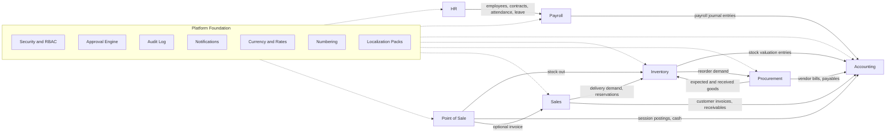
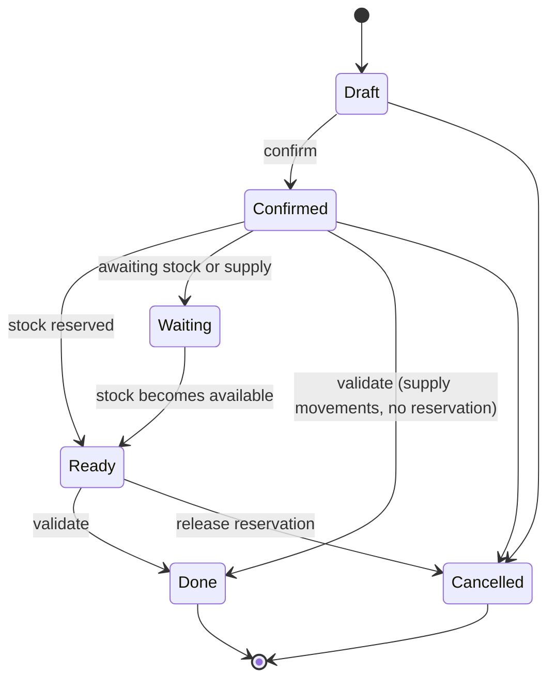
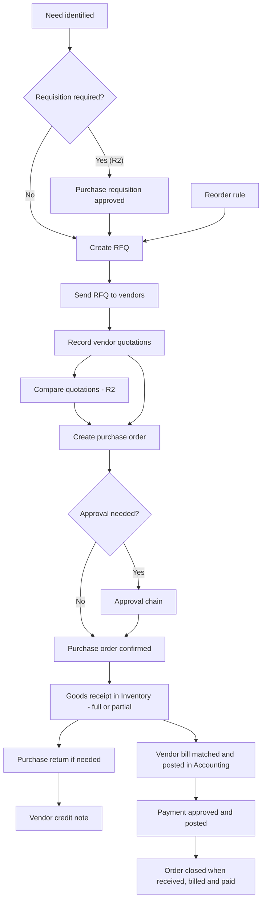

# Enterprise ERP — Master Product Requirements Document (PRD)

> **Status:** DRAFT — Parts 1–2 in progress. Sections 1–14 complete; Section 15 in progress (15.1 Platform, 15.2 Accounting, 15.3 HR, 15.4 Payroll, 15.5 Inventory, 15.6 Procurement written). Remaining sections are listed in the Table of Contents.
> **Reference ERP:** Odoo (official documentation, `odoo.com/documentation`) — used as a functional and business-process reference only. Requirements in this document are independently defined.

---

## Table of Contents

| # | Section | Status |
|---|---|---|
| 1 | Document Information and Version History | Part 1 |
| 2 | Executive Summary | Part 1 |
| 3 | Product Vision | Part 1 |
| 4 | Product Objectives | Part 1 |
| 5 | Business Goals | Part 1 |
| 6 | Business Problems and Proposed Solutions | Part 1 |
| 7 | Product Scope | Part 1 |
| 8 | Out of Scope | Part 1 |
| 9 | Assumptions and Constraints | Part 1 |
| 10 | Stakeholders | Part 1 |
| 11 | User Personas | Part 1 |
| 12 | User Roles and Permissions | Part 1 |
| 13 | ERP Functional Architecture | Part 1 |
| 14 | Shared Master Data Management | Part 1 |
| 15 | Detailed Module Requirements | In progress (15.1–15.6 written; 15.7 Sales and 15.8 POS pending) |
| 16 | End-to-End Business Workflows | Pending |
| 17 | Cross-Module Integration | Pending |
| 18 | Business Rules | Pending |
| 19 | Data Management Requirements | Pending |
| 20 | Reporting and Analytics | Pending |
| 21 | Non-Functional Requirements | Pending |
| 22 | Security and Access Control | Pending |
| 23 | Audit Logging and Compliance | Pending |
| 24 | Notifications and Approvals | Pending |
| 25 | Error Handling and Exception Management | Pending |
| 26 | User Experience Requirements | Pending |
| 27 | External System Integration | Pending |
| 28 | Acceptance Criteria | Pending |
| 29 | Testing Requirements | Pending |
| 30 | MVP Scope and Release Roadmap | Pending |
| 31 | Risks and Mitigation | Pending |
| 32 | Open Questions and Decisions | Pending |
| 33 | Glossary | Pending |
| 34 | References | Pending |

---

## 1. Document Information and Version History

### 1.1 Document Information

| Field | Value |
|---|---|
| Document title | Enterprise ERP — Master Product Requirements Document |
| File name | `prd.md` |
| Product name | *(working title — to be decided)* ERP Suite |
| Document owner | *(student / product owner name — to be filled)* |
| Reviewer | Course instructor |
| Current version | 0.1 (Draft) |
| Date | 2026-11-11 |
| Document status | Draft for review |

### 1.2 Version History

| Version | Date | Author | Description of change |
|---|---|---|---|
| 0.1 | 2026-11-11 | *(owner)* | Initial draft: Sections 1–14 |
| 0.2 | 2026-11-11 | *(owner)* | Added Section 15.1 (Platform) and 15.2 (Accounting) |
| 0.3 | 2026-11-11 | *(owner)* | Added Section 15.3 (HR) and 15.4 (Payroll) |
| 0.4 | 2026-11-11 | *(owner)* | Added Section 15.5 (Inventory) and 15.6 (Procurement) |

### 1.3 Document Conventions

**Requirement ID scheme**

| Prefix | Meaning | Example |
|---|---|---|
| `PLT-FR-nnn` | Platform foundation functional requirement | PLT-FR-001 |
| `ACC-FR-nnn` | Accounting | ACC-FR-001 |
| `HR-FR-nnn` | Human Resource Management | HR-FR-001 |
| `PAY-FR-nnn` | Payroll | PAY-FR-001 |
| `INV-FR-nnn` | Inventory | INV-FR-001 |
| `PUR-FR-nnn` | Procurement / Purchase | PUR-FR-001 |
| `SAL-FR-nnn` | Sales | SAL-FR-001 |
| `POS-FR-nnn` | Point of Sale | POS-FR-001 |
| `INT-nnn` | Cross-module integration | INT-001 |
| `BR-<MOD>-nnn` | Business rule | BR-INV-001 |
| `NFR-<CAT>-nnn` | Non-functional requirement | NFR-PERF-001 |
| `A-nn`, `D-nn`, `OQ-nn`, `R-nn` | Assumption, Decision, Open Question, Risk | A-01 |

**Priority (MoSCoW):** Must Have, Should Have, Could Have, Won't Have (for the stated release).

**Release tags:** **R1** = MVP, **R2** = Release 2, **R3** = Release 3 (see Section 7).

**Reference tags** used when a requirement is informed by Odoo:

| Tag | Meaning |
|---|---|
| `[ODOO-OFFICIAL]` | Behavior confirmed in official Odoo documentation (version named where known) |
| `[ODOO-SECONDARY]` | Described by a non-official source; **not yet verified** against official documentation |
| `[INDEPENDENT]` | Designed independently for this product |
| `[JURISDICTION]` | Depends on country law or regulation; must be verified locally before implementation |

**Proposed targets:** Any numeric target marked **(PROPOSED)** is a recommendation that requires stakeholder approval.

---

## 2. Executive Summary

This document defines the product requirements for a multi-company Enterprise Resource Planning (ERP) system for a **retail and wholesale trading business** that starts operations in **Bangladesh** and plans to expand internationally.

The product has **seven business modules**: Accounting, Human Resource Management (HR), Payroll, Inventory, Procurement, Sales, and Point of Sale (POS). These sit on a shared **platform foundation** that provides multi-company isolation, role-based access control, configurable approvals, audit logging, notifications, currency and exchange-rate management, and document numbering.

The system is designed as a single integrated product, not as seven separate applications. Procurement, Sales, and POS drive Inventory movements; Inventory, Procurement, Sales, POS, and Payroll drive Accounting entries; and HR supplies Payroll. Each piece of master data has exactly one owning module.

**Target profile (confirmed with the product owner):**

| Dimension | Value |
|---|---|
| Industry | Retail and wholesale trading |
| Employees | 200–1,000 |
| Peak concurrent users | 100–500 |
| Products (SKUs) | Up to 5,000 |
| Warehouses / branches | 2–5 |
| Legal entities | Multiple companies, separate books, intercompany transactions in MVP |
| Currency | Multi-currency from day one; base currency BDT |
| Technology | ASP.NET Core, C#, MVC, MySQL, Clean Architecture |
| Deployment | One central ERP server for all branches; backups replicated to a second location |
| Team / timeline | 6–15 people; 6–12+ months |

The delivery strategy is phased: **Release 1 (MVP)** delivers the core transactional workflows of all seven modules; **Release 2** adds advanced capabilities; **Release 3** adds consolidation and external payment integrations.

---

## 3. Product Vision

**Vision statement:** Give a growing trading group a single, trustworthy system of record where every purchase, sale, stock movement, payroll run, and payment is captured once, flows automatically to the right ledger, and can be audited at any time.

**Vision principles**

1. **One transaction, one record.** A business event is entered once; downstream effects (stock, accounting) are generated, not re-keyed.
2. **Books always reconcile.** Subledgers (inventory, receivables, payables, payroll) reconcile to the general ledger at all times.
3. **Configurable, not hard-coded.** Approval limits, salary rules, tax rules, and valuation settings are data owned by the business, not code.
4. **Local first, global ready.** The core is jurisdiction-neutral; Bangladesh rules live in a replaceable localization layer.
5. **Accountable by default.** Sensitive actions are authorized by role, approved when required, and permanently logged.

---

## 4. Product Objectives

| ID | Objective | Measure of success |
|---|---|---|
| OBJ-01 | Provide one integrated platform for the seven modules | All R1 end-to-end workflows (Section 16) pass acceptance tests |
| OBJ-02 | Ensure financial integrity | Zero unbalanced journal entries; subledger-to-GL differences = 0 at period close |
| OBJ-03 | Ensure inventory accuracy and traceability | Every stock quantity change traceable to a source document |
| OBJ-04 | Support multiple companies with strict data isolation | No user can read or write data of a company they are not assigned to |
| OBJ-05 | Support multi-currency operations | Every monetary transaction stores transaction currency, base-currency value, and the exchange rate used |
| OBJ-06 | Enforce controlled approvals and segregation of duties | Approvals configurable by role and amount; no user approves their own transaction |
| OBJ-07 | Be extensible to new countries | A new country can be added through a localization pack without changing core modules |
| OBJ-08 | Provide reliable reporting | Standard financial, stock, procurement, sales, and HR reports available from live data |

---

## 5. Business Goals

> The business has not provided baseline measurements. Targets below are **(PROPOSED)** and need stakeholder approval after baselines are collected (see Open Question OQ-01).

| ID | Business goal | Proposed target | Related modules |
|---|---|---|---|
| BG-01 | Reduce manual re-entry between departments | Zero manual re-keying between Purchase→Inventory→Accounting and Sales→Inventory→Accounting | PUR, INV, SAL, ACC |
| BG-02 | Shorten the monthly financial close | Target to be set after baseline measurement | ACC, PAY, INV |
| BG-03 | Improve stock visibility across 2–5 warehouses | Near-real-time on-hand and reserved quantity per location | INV |
| BG-04 | Reduce payroll preparation effort and errors | Monthly payroll for up to 1,000 employees processed as a controlled batch with verification and approval | PAY, HR |
| BG-05 | Strengthen purchase and spending control | Purchase orders above configured limits cannot be sent without approval | PUR |
| BG-06 | Make audits easier | Any posted financial or stock transaction traceable to user, time, and source document | All |
| BG-07 | Prepare for international expansion | Localization layer separated from core | PLT |

---

## 6. Business Problems and Proposed Solutions

> These are problems **typical of trading businesses**. They have **not yet been validated** with the actual business and must be confirmed in stakeholder interviews (OQ-02).

| # | Typical problem | Proposed solution | Module(s) |
|---|---|---|---|
| P-01 | Purchase, stock, and accounting kept in separate files or tools, causing mismatches | Integrated procure-to-pay with automatic stock and accounting postings | PUR, INV, ACC |
| P-02 | Stock counts differ between warehouses and the books | Location-level stock ledger, inventory adjustments, valuation posted to GL | INV, ACC |
| P-03 | Overbuying or stock-outs | Reordering rules with minimum/maximum levels | INV, PUR |
| P-04 | Unapproved or duplicate purchases and payments | Configurable approvals; duplicate checks on vendor bill reference, payments, and documents | PUR, ACC |
| P-05 | Slow, error-prone payroll based on spreadsheets | Configurable salary structures; attendance and leave feed payroll; batch verification and approval | HR, PAY |
| P-06 | Payroll not linked to the ledger | Approved payroll posts automatically to Accounting | PAY, ACC |
| P-07 | Weak control over cash in retail branches | POS sessions with cash counting and variance recording | POS, ACC |
| P-08 | Difficulty running several legal entities | Multi-company with separate books and recorded intercompany transactions | PLT, ACC |
| P-09 | Foreign-currency purchases lead to untracked exchange differences | Stored exchange rates, realized and unrealized gain/loss handling | ACC |
| P-10 | No audit trail for sensitive changes | Immutable audit log, document locking, reversal instead of deletion | PLT, ACC |
| P-11 | Hard to expand to other countries | Jurisdiction-neutral core with localization packs | PLT |

---

## 7. Product Scope

### 7.1 Scope Summary by Release

| Module | R1 (MVP) | R2 | R3 |
|---|---|---|---|
| **Platform** | Multi-company, users/roles/RBAC, approval engine, audit log, notifications, currencies and rates, sequences, attachments, localization framework | Advanced approval delegation, notification channel extensions | — |
| **Accounting** | Chart of accounts, account groups, journals, general ledger, receivables/payables, customer invoices, vendor bills, payments/receipts, bank & cash, bank statement import and reconciliation, tax management, fiscal years and periods, trial balance, P&L, balance sheet, currency revaluation, intercompany transactions | Cash flow statement, budgets, fixed assets and depreciation | Consolidation |
| **HR** | Employees, profiles, departments, positions, org structure, contracts, documents, joining and exit, attendance (device file import), shifts, leave types/allocation/approval | Recruitment, performance management, transfers and promotions, full lifecycle workflows | — |
| **Payroll** | Salary structures and components, basic salary, allowances, deductions, overtime, bonuses, attendance- and leave-based adjustments, loans and advances, payroll periods, processing, verification and approval, payslips, accounting posting, payroll reports | Final settlement, advanced rule templates | — |
| **Inventory** | Products, categories, variants, units of measure, warehouses, locations, receipts, deliveries, internal transfers, adjustments, reservations, weighted average valuation, reordering rules, min/max levels, movement history, reports, accounting integration | FIFO valuation, lot/serial tracking, expiry management, multi-step receipt/delivery flows | Advanced analytics |
| **Procurement** | Vendors, RFQ, vendor quotations (recorded), purchase orders, purchase approval, goods receipt, partial receipts, purchase returns, vendor bills, purchase payments, purchase history, reports | Purchase requisitions, quotation comparison, purchase agreements | — |
| **Sales** | Customers, quotations, sales orders, deliveries, customer invoicing, price lists, sales returns/credit notes, sales reports | Advanced pricing, discounts and promotions | — |
| **POS** | Terminals, sessions, orders, payments (incl. split payments), receipts, optional invoice per order, cash control, end-of-day reconciliation (online only) | Offline mode | Payment gateway and mobile-financial-service integration |

### 7.2 Cross-Cutting Capabilities in Scope (R1)

- Role-based access control and company-level data isolation.
- Configurable multi-level approvals by role and amount.
- Audit log of sensitive operations.
- Multi-currency with stored exchange rates.
- Bank statement import and attendance device file import.
- English user interface and documents.

### 7.3 Prioritization Note

The release assignments above are the author's proposal. Items from the instructor's brief that appear in R2/R3 are **fully specified** in this PRD but scheduled later. If the instructor expects any of them in the MVP, the roadmap (Section 30) will be adjusted (OQ-03).

---

## 8. Out of Scope

### 8.1 Out of Scope for All Planned Releases

| Item | Reason |
|---|---|
| Manufacturing (bills of materials, work orders, MRP) | Business is trading; confirmed by product owner |
| E-commerce website / online store | Not requested |
| CRM / lead management | Not requested |
| Project management and timesheets | Not requested |
| Native mobile applications | MVC web UI is the primary interface; responsive design only |
| Electronic filing to tax or labor authorities | Jurisdiction-dependent; manual export reports only |

### 8.2 Deferred (Not in R1)

| Item | Planned release |
|---|---|
| Bangla user interface and documents | R2 |
| Offline POS | R2 |
| Consolidated financial statements | R3 |
| Payment gateways and mobile financial services | R3 |
| Public REST API for third parties | Open decision (OQ-09) |

### 8.3 Explicit Non-Goals

- Copying Odoo's implementation, screens, or data model.
- Inventing country-specific tax rates, payroll deductions, or labor-law rules. These are recorded as `[JURISDICTION]` items and must be supplied and verified by qualified local advisors.

---

## 9. Assumptions and Constraints

### 9.1 Confirmed Decisions

| ID | Decision | Source |
|---|---|---|
| D-01 | Business type: retail and wholesale trading | Product owner |
| D-02 | Initial market: Bangladesh; international expansion planned | Product owner |
| D-03 | Seven modules: Accounting, HR, Payroll, Inventory, Procurement, Sales, POS | Product owner |
| D-04 | Multiple companies with separate books; intercompany in MVP; consolidation later | Product owner |
| D-05 | Multi-currency from day one; base currency BDT | Product owner |
| D-06 | Weighted average cost valuation in MVP; FIFO in Release 2 | Product owner (recommended option) |
| D-07 | Stack: ASP.NET Core, C#, MVC, MySQL, Clean Architecture | Product owner |
| D-08 | Deployment: one central server for all branches; backups replicated to a second location | Product owner |
| D-09 | POS online-only in MVP; offline in Release 2 | Product owner |
| D-10 | English in MVP; Bangla in Release 2 | Product owner |
| D-11 | MVP integrations: bank statement import and attendance device import | Product owner |
| D-12 | Approvals: configurable multi-level by role and amount | Product owner |
| D-13 | Team size 6–15; timeline 6–12+ months | Product owner |

### 9.2 Assumptions

| ID | Assumption | Risk if wrong |
|---|---|---|
| A-01 | All companies in the group share one central deployment | Architecture rework if separate hosting is required |
| A-02 | Each company keeps its own chart of accounts, fiscal calendar, and base currency setting | Reporting rework |
| A-03 | Stock cannot be shared between companies except through intercompany transactions | Inventory model changes |
| A-04 | The UI is server-rendered MVC; no separate SPA or public API in R1 | Integration scope changes |
| A-05 | Accrual accounting is the default; cash basis reporting is not required in R1 | Report additions |
| A-06 | Customers and vendors are stored as one business-partner entity with role flags | Master data redesign |
| A-07 | Salary structures and rules are business-defined configuration | Payroll engine changes |
| A-08 | Receipts and deliveries are one-step in R1 | Warehouse flow changes |
| A-09 | Branches are warehouses/locations or POS terminals under a company, not separate legal entities | Multi-company model changes |
| A-10 | All proposed numeric targets will be approved or revised by stakeholders | Non-functional rework |

### 9.3 Constraints

| ID | Type | Constraint |
|---|---|---|
| C-01 | Technical | ASP.NET Core, C#, MVC, MySQL, Clean Architecture |
| C-02 | Technical | No source code is produced during the requirements phase |
| C-03 | Regulatory | Bangladesh-specific rules cannot be assumed; they require local verification `[JURISDICTION]` |
| C-04 | Organizational | Team of 6–15 people; 6–12+ months |
| C-05 | Operational | Central server: branches depend on network connectivity to the central site |
| C-06 | Process | Odoo is a reference only; each behavior must be checked against its documentation before being treated as verified |

---

## 10. Stakeholders

| Stakeholder | Interest | Involvement |
|---|---|---|
| Business owner / executive sponsor | Overall success, control, reporting | Approves scope, budget, priorities |
| Finance head / chief accountant | Accurate books, closing, tax, reporting | Accounting requirements, sign-off |
| HR head | Employee records, leave, attendance | HR requirements |
| Payroll officer / HR-finance | Correct, timely, approved payroll | Payroll rules, verification |
| Warehouse managers | Stock accuracy, receiving, delivery | Inventory workflows |
| Procurement head | Vendor management, cost control | Procurement workflows |
| Sales / retail head | Order-to-cash, POS operations | Sales and POS requirements |
| Branch managers / cashiers | Daily selling and cash control | POS usability |
| Employees | Self-service leave, payslips | Self-service features |
| Internal / external auditor | Auditability, controls | Audit and compliance requirements |
| Tax and legal advisor | Local compliance | Localization verification `[JURISDICTION]` |
| IT / system administrator | Hosting, backup, security | Deployment and operations |
| Development team (6–15) | Clear, testable requirements | Design and build |
| QA / test team | Testable acceptance criteria | Test planning |
| Course instructor | Document quality and completeness | Review and grading |

---

## 11. User Personas

> Personas are **illustrative** and are based on typical roles. Names are fictional. They must be validated with real users (OQ-02).

| Persona | Role | Goals | Typical pain points | Main modules |
|---|---|---|---|---|
| **Rahim** — Chief Accountant | Finance Manager | Accurate books, quick close, audit-ready records | Reconciling subledgers, chasing missing documents, FX differences | ACC |
| **Nusrat** — AP/AR Clerk | Accountant | Fast invoice/bill entry, payment matching | Duplicate bills, unmatched payments | ACC, PUR, SAL |
| **Karim** — HR Manager | HR Manager | Complete employee records, controlled leave and attendance | Paper records, manual leave balances | HR |
| **Sultana** — Payroll Officer | Payroll Officer | Correct payroll on time | Manual calculation, late attendance data | PAY, HR |
| **Jamal** — Warehouse Manager | Warehouse Manager | Accurate stock, smooth receiving and delivery | Count differences, missing receipts | INV |
| **Farida** — Procurement Manager | Procurement Manager | Right vendor, right price, approved orders | Unapproved orders, late deliveries | PUR |
| **Tanvir** — Sales Manager | Sales Manager | Quote-to-cash visibility | Unknown stock availability | SAL, INV |
| **Mitu** — Cashier | Cashier | Fast checkout, balanced drawer | Cash differences, slow lookups | POS |
| **Habib** — Branch Employee | Employee (self-service) | View payslips, request leave | No visibility of balances | HR, PAY |
| **Aziz** — Internal Auditor | Auditor (read-only) | Trace any transaction end to end | Missing trails | All |

---

## 12. User Roles and Permissions

### 12.1 Permission Model

A permission is the combination of **action × resource × data scope**.

- **Actions:** View, Create, Edit, Delete (draft only), Submit, Approve, Post, Reverse, Export, Configure.
- **Resources:** documents and master data of each module.
- **Data scopes:** Company, Branch/Warehouse, Department, Own records.

Rules:

- **PLT-RBAC-01** Every user is assigned to one or more companies; access outside assigned companies is denied.
- **PLT-RBAC-02** Roles are configurable; the roles below are the default set.
- **PLT-RBAC-03** Users can hold multiple roles; effective permission is the union of roles, subject to the segregation-of-duties rules in 12.3.
- **PLT-RBAC-04** Salary, bank, and personal data are restricted to roles explicitly granted access.

### 12.2 Default Roles and Module Access

**Legend:** `A` = Administer / configure · `F` = Full operate (create, edit, post) · `X` = Approve · `O` = Operate (create/edit, no posting or approval) · `V` = View · `S` = Self-service (own records) · `—` = No access

| Role | PLT | ACC | HR | PAY | INV | PUR | SAL | POS |
|---|---|---|---|---|---|---|---|---|
| System Administrator | A | — | — | — | — | — | — | — |
| Company Administrator | A | V | V | — | V | V | V | V |
| Finance Manager | V | A, F, X | — | X (accounting posting) | V | V | V | V |
| Accountant | — | F | — | V (journals only) | V | V | V | V |
| AP/AR Clerk | — | O | — | — | — | V | V | — |
| HR Manager | — | — | A, F, X | V | — | — | — | — |
| HR Officer | — | — | O | — | — | — | — | — |
| Payroll Officer | — | — | V | F | — | — | — | — |
| Payroll Approver | — | — | V | X | — | — | — | — |
| Line Manager | — | — | X (team leave/attendance) | — | — | O (requisition) | — | — |
| Employee | — | — | S | S | — | — | — | — |
| Warehouse Manager | — | — | — | — | A, F, X | V | V | V |
| Warehouse Operator | — | — | — | — | O | — | — | — |
| Procurement Manager | — | V | — | — | V | A, F, X | — | — |
| Purchase Officer | — | — | — | — | V | O | — | — |
| Sales Manager | — | V | — | — | V | — | A, F, X | V |
| Sales Officer | — | — | — | — | V | — | O | — |
| POS Manager | — | V | — | — | V | — | V | A, F, X |
| Cashier | — | — | — | — | — | — | — | O |
| Internal Auditor | V | V | V | V | V | V | V | V |
| Executive / Viewer | V | V | V | V | V | V | V | V |

> Notes: (1) The System Administrator manages platform settings and users but has no business-transaction access by default. (2) The Internal Auditor is strictly read-only and can view audit logs. (3) Approval limits per role (amounts) are **not fixed here**; they are business configuration (OQ-04).

### 12.3 Segregation-of-Duties (SoD) Rules

| ID | Rule |
|---|---|
| SOD-01 | A user cannot approve a document they created |
| SOD-02 | The person who creates a vendor cannot also approve a payment to that vendor |
| SOD-03 | A payroll preparer cannot be the payroll approver for the same payroll run |
| SOD-04 | A user who creates or edits an employee's bank or salary data cannot approve payroll for that employee |
| SOD-05 | A user who posts a stock adjustment cannot approve the same adjustment |
| SOD-06 | A user cannot approve their own leave request |
| SOD-07 | A cashier cannot close and reconcile their own POS session above the configured variance threshold |
| SOD-08 | A user who requested a purchase cannot approve the corresponding purchase order |

*All SoD rules are `[INDEPENDENT]` and may be relaxed by configuration where the business requires it, with the relaxation itself being logged.*

---

## 13. ERP Functional Architecture

### 13.1 Architectural Principles

1. **Modular bounded contexts.** Each module owns its domain model, rules, and data; modules do not write directly to each other's data.
2. **Platform services are shared.** Cross-cutting capabilities (security, approvals, audit, numbering, currency) are implemented once.
3. **Integration through defined contracts.** Modules communicate through application-level contracts and business events, not through direct table access.
4. **Transactional integrity for business events.** A business event and its dependent postings (for example, a stock receipt and its accounting entry) succeed or fail together.
5. **Company scoping everywhere.** Every transactional record belongs to exactly one company.

### 13.2 Layering (Clean Architecture mapping)

| Layer | Responsibility in this product |
|---|---|
| **Domain** | Entities, value objects, domain rules, and domain events per bounded context (for example, journal entry balancing rule, stock move rules) |
| **Application** | Use cases, workflows, approval orchestration, cross-module contracts, validation |
| **Infrastructure** | MySQL persistence, file storage, import adapters (bank statement, attendance device), notification delivery, backup tooling |
| **Presentation** | ASP.NET Core MVC web UI, role-aware menus, report views |

Dependency direction: Presentation → Application → Domain; Infrastructure implements interfaces defined by Application/Domain. *(This section describes structure only; no code is produced at this stage.)*

### 13.3 Module Map

### 13.4 Bounded Contexts and Ownership

| Context | Owns | Publishes events (examples) | Consumes |
|---|---|---|---|
| Accounting | Chart of accounts, journals, ledgers, taxes, fiscal calendar, bank accounts, payments | Entry posted, period closed | Events from all transactional modules |
| HR | Employees, departments, positions, contracts, shifts, leave types, attendance | Employee joined/exited, leave approved, contract changed | — |
| Payroll | Salary structures, components, loans, payroll runs, payslips | Payroll approved/posted | HR data |
| Inventory | Products, categories, UoM, warehouses, locations, stock moves, valuation | Stock received, stock delivered, stock adjusted, below minimum | Purchase, Sales, POS |
| Procurement | Purchase orders, RFQs, vendor price info, returns | PO confirmed, goods received, return created | Inventory reorder demand |
| Sales | Quotations, orders, price lists | Order confirmed, delivery requested | Inventory availability |
| POS | Terminals, sessions, POS orders | Session closed | Product, price, stock |
| Platform | Users, roles, companies, approvals, audit, numbering, currency rates | Approval decided | — |

### 13.5 Platform Services

| Service | Key capabilities |
|---|---|
| Company management | Companies, branches, company-level settings |
| Security | Authentication, roles, permissions, session policy |
| Approval engine | Approval chains by role and amount, delegation (R2), decision history |
| Audit log | Immutable log of sensitive actions |
| Notification | In-app and email notifications for approvals and alerts |
| Currency and rates | Currencies, daily rates, rate source and history |
| Numbering | Gap-controlled document sequences per company and document type |
| Attachments | Documents attached to records, with access control |
| Localization | Country packs: tax templates, chart-of-accounts template, payroll rule templates, statutory report formats |

### 13.6 Integration Style

- **Synchronous (same transaction):** Postings that must be consistent with the source event (for example, a goods receipt and its stock valuation entry).
- **Asynchronous (event-based):** Non-critical downstream effects (for example, notifications, reorder alerts).
- **Idempotency:** Every cross-module posting carries a unique source-document reference so that retries cannot create duplicates.

Detailed integration specifications appear in Section 17.

### 13.7 Deployment View

| Aspect | Requirement (R1) |
|---|---|
| Application and database | One central ERP server (application tier and MySQL) serving all companies and branches |
| Client access | Web browser at all locations; POS terminals require network connectivity to the central server (offline in R2) |
| Backup and recovery | Backups replicated to a second location; exact schedule, retention, and recovery targets are defined in Section 21 **(PROPOSED)** |
| Hosting location | Open decision (OQ-06): cloud, on-premises, or a mix for the central site and the second location |

---

## 14. Shared Master Data Management

### 14.1 Principles

- **MD-P1:** Each master entity has **one owning module**; other modules reference it and cannot alter it.
- **MD-P2:** Master data is never physically deleted once referenced; it is **archived**.
- **MD-P3:** Unique keys prevent duplicates (for example, tax identifier plus company for a partner, SKU code for a product).
- **MD-P4:** Changes to sensitive master data are audit-logged and may require approval.
- **MD-P5:** Master data is either **global** (shared across companies) or **company-scoped**, as defined below.

### 14.2 Master Data Catalog

| Entity | Owner | Scope | Consumers | Notes |
|---|---|---|---|---|
| Company / Branch | Platform | Global | All | Defines base currency, fiscal calendar, localization pack |
| User / Role | Platform | Global (with company assignments) | All | |
| Currency / Exchange rate | Platform | Global | ACC, PUR, SAL, POS, PAY | Rate history is retained; rates are never overwritten |
| Document sequences | Platform | Company | All | |
| Business partner (customer, vendor) | Accounting* | Global record, company-specific accounting settings | PUR, SAL, POS | One record with role flags (A-06). *Ownership is confirmed in OQ-07 |
| Chart of accounts / Account groups | Accounting | Company | All | Separate per company (A-02) |
| Tax / Tax rules | Accounting | Company | PUR, SAL, POS, INV | Values are `[JURISDICTION]` and loaded from a localization pack |
| Fiscal year / Period | Accounting | Company | All | |
| Bank / Cash account | Accounting | Company | PUR, SAL, POS, PAY | |
| Payment terms | Accounting | Company | PUR, SAL | |
| Product / Variant / Category | Inventory | Global product, company-specific stock and cost | PUR, SAL, POS, ACC | Single product record used by all |
| Unit of measure | Inventory | Global | PUR, SAL, POS | Conversions within a UoM category |
| Warehouse / Location | Inventory | Company | PUR, SAL, POS | |
| Price list | Sales | Company | SAL, POS | |
| Vendor price information | Procurement | Company | PUR | Vendor-specific prices and lead times for products |
| Employee | HR | Company | PAY, PLT | Personal and employment data |
| Department / Job position | HR | Company | PAY, PUR (requesting department) | |
| Contract | HR | Company | PAY | Effective-dated |
| Shift / Working schedule | HR | Company | PAY, HR | |
| Leave type | HR | Company | PAY | |
| Salary structure / Component | Payroll | Company | PAY | |
| POS terminal | POS | Company | POS | |

### 14.3 Master Data Requirements

| ID | Requirement | Priority | Release |
|---|---|---|---|
| PLT-MD-001 | The system shall enforce a unique business-partner identity using the tax identifier (where provided) together with company-level duplicate checks and warn the user of likely duplicates | Must Have | R1 |
| PLT-MD-002 | The system shall prevent deletion of any master record referenced by a transaction; such records can only be archived | Must Have | R1 |
| PLT-MD-003 | The system shall store exchange rates with date, source, and entered-by, and preserve historical rates | Must Have | R1 |
| PLT-MD-004 | The system shall maintain effective dates for contracts, salary structures, and prices so that historical transactions are recalculated using values valid at the time | Must Have | R1 |
| PLT-MD-005 | The system shall log every change to sensitive master data (partner bank details, employee salary and bank data, chart of accounts, tax settings) with old value, new value, user, and time | Must Have | R1 |
| PLT-MD-006 | The system shall provide import of master data (products, partners, employees, opening balances) from structured files with validation and an error report | Should Have | R1 |
| PLT-MD-007 | The system shall allow merging of duplicate partners or products, re-pointing references and keeping a record of the merge | Could Have | R2 |

### 14.4 Ownership Decisions Needing Confirmation

- **OQ-07:** Business partner ownership — this draft assigns it to Accounting because both receivables and payables depend on it; alternatively it could be a platform-level entity. Decision required before design.
- **OQ-08:** Whether products are shared across companies (one global product with per-company stock/cost) or fully separate per company. This draft proposes **global product, company-specific stock and cost** (A-03).

---

## Part 1 Open Questions (carried to Section 32)

| ID | Question | Needed by |
|---|---|---|
| OQ-01 | What are the current baselines (month-end close time, payroll preparation time, stock count differences)? | Before finalizing Section 5 targets |
| OQ-02 | Which real stakeholders can validate the problems and personas? | Before Part 2 |
| OQ-03 | Does the instructor expect any R2/R3 items in the MVP? | Before Section 30 |
| OQ-04 | What are the approval thresholds by role and amount? | Before Section 24 |
| OQ-05 | Which accounting standard and chart-of-accounts template does the business follow? | Before Section 15 (Accounting) |
| OQ-06 | Where will the central site and the second backup location be hosted? | Before Section 21 |
| OQ-07 | Which module or platform layer owns the business partner? | Before design |
| OQ-08 | Are products shared across companies? | Before Section 15 (Inventory) |
| OQ-09 | Is a public API needed in R1 or later? | Before Section 27 |

---

## 15. Detailed Module Requirements

### 15.0 How to Read This Section

Each functional requirement (FR) uses this structure: **Description, Business Objective, Actor, Preconditions, Trigger, Main Workflow, Alternative Workflow, Business Rules, Validation Rules, Exception Scenarios, Expected Outcome, Acceptance Criteria, Priority**. Reference tags are defined in Section 1.3. Business rules (`BR-…`) defined here are consolidated in Section 18. Acceptance criteria use *Given / When / Then* shorthand and are expanded into test cases in Section 29.

Release tags: **R1** MVP · **R2** Release 2 · **R3** Release 3.

---

### 15.1 Platform Foundation

#### PLT-FR-001 — Manage Companies and Branches
- **Priority:** Must Have · **Release:** R1 · **Ref:** `[ODOO-OFFICIAL]` multi-company with separate chart of accounts per company; `[INDEPENDENT]` branch model
- **Description:** Create and maintain legal entities (companies) and their branches, each with base currency, fiscal calendar settings, localization pack, address and tax identifiers.
- **Business Objective:** Support multiple legal entities with separate books (D-04).
- **Actor:** System Administrator, Company Administrator.
- **Preconditions:** Actor has Administer rights on Platform; at least one currency exists.
- **Trigger:** A new legal entity or branch is established.
- **Main Workflow:** 1) Actor opens Company Management. 2) Enters legal name, registration and tax identifiers, address, base currency, localization pack, fiscal year start. 3) Saves. 4) System creates the company with an empty chart of accounts, sequences, and default journals ready for setup.
- **Alternative Workflow:** Company created from a template (chart of accounts and taxes loaded from the selected localization pack).
- **Business Rules:** BR-PLT-001 every transactional record belongs to exactly one company. BR-PLT-002 base currency cannot change once any transaction is posted. A branch belongs to one company and is not a separate legal entity (A-09).
- **Validation Rules:** Legal name and base currency mandatory; tax identifier format validated by the localization pack; branch codes unique within a company.
- **Exception Scenarios:** Attempt to change base currency after posting → rejected with explanation. Attempt to delete a company with data → rejected; company can only be archived.
- **Expected Outcome:** Company exists and is selectable by assigned users.
- **Acceptance Criteria:** AC-1 Given a company with posted entries, when base currency is edited, then the change is rejected. AC-2 Given two companies, when a user assigned to only one searches, then no records of the other company are visible. AC-3 Creating a company from a localization pack produces a chart of accounts and tax set matching the pack.

#### PLT-FR-002 — Manage Users, Roles, and Permissions
- **Priority:** Must Have · **Release:** R1 · **Ref:** `[INDEPENDENT]`
- **Description:** Create users, assign them to companies and roles, and define role permissions as action × resource × data scope (Section 12.1).
- **Business Objective:** Enforce role-based access control and segregation of duties.
- **Actor:** System Administrator.
- **Preconditions:** Companies exist.
- **Trigger:** A person joins, changes role, or leaves.
- **Main Workflow:** 1) Admin creates user with unique login and email. 2) Assigns companies and roles. 3) System applies effective permissions at next sign-in. 4) Admin can deactivate the user.
- **Alternative Workflow:** Bulk user import from a structured file with validation report.
- **Business Rules:** BR-PLT-003 effective permissions are the union of the user's roles, but segregation-of-duties rules (SOD-01 to SOD-08) always prevail. Users cannot be deleted once they have performed any action; they are deactivated.
- **Validation Rules:** Unique login; password policy per Section 22; at least one company and one role.
- **Exception Scenarios:** Assigning conflicting roles that violate a SoD rule → warning, and assignment requires a logged justification by an authorized role. Deactivated user attempts login → denied and logged.
- **Expected Outcome:** User can access only permitted companies, modules, and actions.
- **Acceptance Criteria:** AC-1 Given a user without PAY access, when opening a payslip URL directly, then access is denied and logged. AC-2 Given a deactivated user, when signing in, then login fails. AC-3 Role change takes effect at the next sign-in.

#### PLT-FR-003 — Configure Approval Rules
- **Priority:** Must Have · **Release:** R1 · **Ref:** `[INDEPENDENT]`; secondary sources describe approval by amount, category, or department `[ODOO-SECONDARY]`
- **Description:** Define approval chains per document type with conditions (amount range, currency, company, branch, department, product category) and ordered approver roles.
- **Business Objective:** Make approvals a business configuration rather than code (D-12).
- **Actor:** Company Administrator (configures), Finance/HR/Procurement Managers (propose).
- **Preconditions:** Roles exist; document type supports approvals.
- **Trigger:** The business sets or changes approval policy.
- **Main Workflow:** 1) Actor selects document type (for example purchase order, leave request, payroll run, stock adjustment, journal entry). 2) Adds rules: condition + ordered approver roles (levels). 3) Sets effective-from date. 4) Saves; system versions the rule set.
- **Alternative Workflow:** Copy an existing rule set to another company.
- **Business Rules:** BR-PLT-004 an approval request uses the rule version active at submission; later rule changes do not alter in-flight requests. Amount comparisons use the company base currency. Overlapping conditions resolve by priority number.
- **Validation Rules:** Ranges must not leave gaps that would allow bypass; each level has at least one eligible approver; the submitter cannot be the only approver (SOD-01).
- **Exception Scenarios:** No rule matches a submitted document → system applies a configurable default (block or auto-approve), which must be explicitly set; undefined default blocks submission.
- **Expected Outcome:** Approval policy is stored, versioned, and applied automatically.
- **Acceptance Criteria:** AC-1 Given a purchase order of an amount in the second range, when submitted, then it routes through the levels defined for that range. AC-2 Given a rule change after submission, then in-flight requests keep the old chain. AC-3 Rule changes appear in the audit log.

#### PLT-FR-004 — Process Approval Requests
- **Priority:** Must Have · **Release:** R1 · **Ref:** `[INDEPENDENT]`; leave approval pattern `[ODOO-SECONDARY]`
- **Description:** Route documents to approvers, capture decisions with comments, and release or reject the document.
- **Business Objective:** Control spending, payroll, stock changes, and leave through documented approvals.
- **Actor:** Submitter, Approver.
- **Preconditions:** Document is complete and valid; an approval rule applies.
- **Trigger:** Submitter submits the document for approval.
- **Main Workflow:** 1) System evaluates rule, creates request at level 1, locks the document for editing. 2) Approver is notified (PLT-FR-006). 3) Approver approves or rejects with comment. 4) On approval, next level or final approval; document moves to Approved. 5) On rejection, document returns to Draft with the reason.
- **Alternative Workflow:** Approver reassigns to another eligible user; request is recalled by the submitter before the first decision.
- **Business Rules:** SOD-01 and all related SoD rules apply. A decision is final and cannot be edited; a reversal requires a new request. Pending requests older than a configurable threshold trigger escalation notifications.
- **Validation Rules:** Approver must hold the required role and company access at decision time; comment mandatory on rejection.
- **Exception Scenarios:** Approver deactivated mid-chain → request returns to the pool of eligible approvers at that level and the submitter is notified. Document edited during pending approval → not allowed.
- **Expected Outcome:** Every controlled document has a complete decision history.
- **Acceptance Criteria:** AC-1 Submitter cannot approve own document. AC-2 Rejection requires a comment and returns the document to Draft. AC-3 The full chain, approvers, timestamps, and comments are viewable on the document.

#### PLT-FR-005 — Record and View Audit Log
- **Priority:** Must Have · **Release:** R1 · **Ref:** `[INDEPENDENT]`
- **Description:** Record an immutable log of sensitive operations and make it searchable by authorized roles.
- **Business Objective:** Provide traceability for audits (BG-06).
- **Actor:** System (records); Internal Auditor, System Administrator, authorized managers (view).
- **Preconditions:** Auditing is always on and cannot be disabled.
- **Trigger:** A logged action occurs (Section 23 lists the full catalog).
- **Main Workflow:** 1) System captures user, company, time, action, record type and identifier, old and new values, source IP, and result. 2) Entry is stored append-only. 3) Authorized users search by user, date, record, or action and export.
- **Alternative Workflow:** Failed or denied attempts are also logged.
- **Business Rules:** BR-PLT-005 audit records cannot be edited or deleted by any user, including administrators. Retention period is configurable and proposed in Section 21 `[PROPOSED]`.
- **Validation Rules:** Log entries must include user and timestamp; entries missing mandatory fields cannot be written and the originating action fails.
- **Exception Scenarios:** Audit storage unavailable → the sensitive action is blocked rather than performed without a log.
- **Expected Outcome:** Any sensitive change can be reconstructed.
- **Acceptance Criteria:** AC-1 Given a salary change, then the log shows old value, new value, user, and time. AC-2 No UI or role allows deleting a log entry. AC-3 Log search by record returns entries in time order.

#### PLT-FR-006 — Send Notifications
- **Priority:** Should Have · **Release:** R1 · **Ref:** `[INDEPENDENT]`
- **Description:** Deliver in-app and email notifications for approvals, alerts, and reminders.
- **Business Objective:** Keep approvals and exceptions moving.
- **Actor:** System; recipients.
- **Preconditions:** Recipient has a valid contact; notification type enabled.
- **Trigger:** Approval requested/decided, document overdue, stock below minimum, contract or document expiring, period closing reminder.
- **Main Workflow:** 1) Event occurs. 2) System resolves recipients by role and scope. 3) Creates in-app notification and queues email. 4) Marks as read when opened.
- **Alternative Workflow:** User mutes non-mandatory notification types; mandatory approval notifications cannot be muted.
- **Business Rules:** Notifications never contain sensitive data such as salary amounts in email bodies; they link to the record instead.
- **Validation Rules:** Recipient must have permission to view the linked record.
- **Exception Scenarios:** Email delivery failure → retried a configurable number of times, then flagged; in-app notification still exists.
- **Expected Outcome:** Relevant users are informed within the proposed time target (Section 21).
- **Acceptance Criteria:** AC-1 Submitting a purchase order for approval creates an in-app notification for the approver. AC-2 Notification links open only for users with access.

#### PLT-FR-007 — Manage Currencies and Exchange Rates
- **Priority:** Must Have · **Release:** R1 · **Ref:** `[ODOO-OFFICIAL]` stores both company-currency and transaction-currency amounts; `[INDEPENDENT]` rate-handling rules
- **Description:** Maintain active currencies and dated exchange rates, entered manually or imported from a file; provide rate lookup for all modules.
- **Business Objective:** Support multi-currency from day one (D-05).
- **Actor:** Finance Manager, Accountant.
- **Preconditions:** Company base currency defined.
- **Trigger:** Rate changes or a foreign-currency transaction needs a rate.
- **Main Workflow:** 1) Actor activates a currency. 2) Enters or imports the rate with date and source. 3) Modules use the latest rate on or before the transaction date. 4) System stores the rate used on each transaction.
- **Alternative Workflow:** User with permission overrides the rate on a single transaction; the override is flagged and logged.
- **Business Rules:** BR-PLT-006 rates are never overwritten; a new dated rate is added. If no rate exists on or before the date, the transaction cannot be saved unless an authorized user enters a manual rate. Automatic online rate retrieval is a future option (OQ-10).
- **Validation Rules:** Rate > 0; one rate per currency and date and source; rate source mandatory.
- **Exception Scenarios:** Imported rate file with invalid rows → valid rows imported, invalid rows reported. Rate gap on a transaction date → blocked as above.
- **Expected Outcome:** Each foreign-currency transaction stores currency, original amount, base amount, and the rate used.
- **Acceptance Criteria:** AC-1 A new rate does not change past posted transactions. AC-2 A bill dated before the first available rate is blocked without manual rate. AC-3 Rate history is retained and viewable.

#### PLT-FR-008 — Manage Document Numbering
- **Priority:** Must Have · **Release:** R1 · **Ref:** `[INDEPENDENT]`; gap rules `[JURISDICTION]`
- **Description:** Define sequences per company, document type, and optionally branch or fiscal year; assign numbers when documents are confirmed or posted.
- **Business Objective:** Unique, traceable document identifiers; prevent duplicates.
- **Actor:** Company Administrator.
- **Preconditions:** Company exists.
- **Trigger:** A document is confirmed or posted.
- **Main Workflow:** 1) Admin defines a prefix, pattern, and reset rule. 2) On confirmation the system assigns the next number atomically. 3) The number is stored on the document.
- **Alternative Workflow:** Sequence reset at fiscal-year start if configured.
- **Business Rules:** BR-PLT-007 numbers are unique per company and document type; a confirmed document keeps its number permanently, including after cancellation. Whether numbers must be strictly gap-free is jurisdiction-dependent and is an open question (OQ-11).
- **Validation Rules:** Pattern must be unique per scope; concurrent requests must never produce the same number.
- **Exception Scenarios:** Failure after number assignment → rollback policy defined in design; no two documents may share a number.
- **Expected Outcome:** Every confirmed business document has a unique number.
- **Acceptance Criteria:** AC-1 Two users confirming simultaneously receive different numbers. AC-2 Cancelled documents retain their numbers.

#### PLT-FR-009 — Manage Localization Packs
- **Priority:** Should Have · **Release:** R1 (framework and Bangladesh pack shell), content verified before go-live · **Ref:** `[ODOO-OFFICIAL]` country-specific modules and fiscal positions exist; `[JURISDICTION]`
- **Description:** Provide a replaceable pack per country containing chart-of-accounts template, tax templates, payroll rule templates, statutory report layouts, and legal text.
- **Business Objective:** Keep the core jurisdiction-neutral and ready for international expansion (OBJ-07).
- **Actor:** Company Administrator; Tax/Legal Advisor supplies content.
- **Preconditions:** Pack content verified by a qualified local advisor.
- **Trigger:** A company is created or localization is changed.
- **Main Workflow:** 1) Admin selects a pack for a company. 2) System loads templates as editable company configuration. 3) Company adjusts as needed.
- **Alternative Workflow:** Company runs without a pack, with all configuration entered manually.
- **Business Rules:** Pack content carries a "verified by / date" attribute. **No tax rate, payroll deduction, or labor-law value may be shipped without verification** `[JURISDICTION]`.
- **Validation Rules:** Pack version recorded on the company; unverified packs display a warning.
- **Exception Scenarios:** Pack updated after company use → changes are not applied automatically; admin reviews and applies selectively.
- **Expected Outcome:** A company can start with a verified local configuration.
- **Acceptance Criteria:** AC-1 Pack loading never overwrites existing posted data. AC-2 Unverified pack content shows a visible warning.

---

### 15.2 Accounting Management

**Module purpose:** System of record for all financial transactions of each company. Other modules post to Accounting through defined integrations (Section 17); users can also post manual entries. Accounting owns the chart of accounts, journals, taxes, fiscal calendar, bank accounts, and payments.

**Reference summary** `[ODOO-OFFICIAL]` (Odoo "latest" documentation, accounting overview): automatic double-entry journal entries for all transactions; accrual and cash basis; multi-company with a chart of accounts per company; multi-currency storing both company-currency and transaction-currency values, with gains/losses generated after reconciliation; tax report locking after generation; valuation methods standard/average/LIFO/FIFO; retained earnings computed in real time; a catalog of financial, audit, partner, and management reports. **Our design differs** where noted (for example, defined period states and an explicit revaluation workflow).

**Release split:** R1: ACC-FR-001 to 017. R2: ACC-FR-018 to 020. R3: consolidation (specified in Section 30 roadmap).

#### ACC-FR-001 — Manage Chart of Accounts and Account Groups
- **Priority:** Must Have · **Release:** R1 · **Ref:** `[ODOO-OFFICIAL]` chart of accounts per company; `[JURISDICTION]` template content
- **Description:** Create and maintain accounts (code, name, type, currency restriction, reconcilable flag, tax defaults) organized in hierarchical account groups.
- **Business Objective:** Provide a structured, company-specific ledger framework.
- **Actor:** Finance Manager.
- **Preconditions:** Company exists; account types defined (asset, liability, equity, income, expense, receivable, payable, bank/cash, and so on).
- **Trigger:** Company setup or a new reporting need.
- **Main Workflow:** 1) Actor loads a template from the localization pack or starts empty. 2) Creates or edits accounts and groups. 3) Marks accounts active. 4) System enforces type rules on usage.
- **Alternative Workflow:** Import accounts from a file with validation report.
- **Business Rules:** BR-ACC-004 account type governs allowed usage (for example, receivable/payable accounts require a partner on each line). Accounts with posted lines cannot be deleted, and their type cannot change; they can be archived (blocked if balance ≠ 0). Account codes unique per company.
- **Validation Rules:** Code and type mandatory; group hierarchy must not form cycles; currency restriction must match an active currency.
- **Exception Scenarios:** Archiving an account with a non-zero balance → rejected. Changing type on a used account → rejected.
- **Expected Outcome:** A valid, hierarchical chart of accounts per company.
- **Acceptance Criteria:** AC-1 Two companies have independent charts. AC-2 An account with posted lines cannot be deleted. AC-3 A receivable account line without a partner is rejected.

#### ACC-FR-002 — Manage Journals
- **Priority:** Must Have · **Release:** R1 · **Ref:** `[ODOO-OFFICIAL]` journals underpin entries (sales, purchase, bank, cash, misc); `[INDEPENDENT]`
- **Description:** Configure journals by type (sales, purchase, bank, cash, payroll, inventory valuation, miscellaneous, intercompany) with default accounts, currency, and numbering.
- **Business Objective:** Separate transaction streams for control and reporting.
- **Actor:** Finance Manager.
- **Preconditions:** Chart of accounts exists.
- **Trigger:** Company setup; new bank account; new integration.
- **Main Workflow:** 1) Actor creates journal with type, code, default accounts, sequence. 2) Saves. 3) Modules select journals by type and company.
- **Alternative Workflow:** System creates default journals when a company is created.
- **Business Rules:** Journal code unique per company; a journal's type restricts the account types on its default accounts; a journal in use cannot be deleted, only archived.
- **Validation Rules:** Bank/cash journals require a linked bank/cash account.
- **Exception Scenarios:** Archiving a journal with open drafts → rejected until drafts are resolved.
- **Expected Outcome:** Journals available for all document types.
- **Acceptance Criteria:** AC-1 Posting an invoice uses the company's sales journal and sequence. AC-2 A used journal cannot be deleted.

#### ACC-FR-003 — Create Journal Entry (Manual)
- **Priority:** Must Have · **Release:** R1 · **Ref:** `[ODOO-OFFICIAL]` entries are double-entry and balanced
- **Description:** Create a manual journal entry with two or more lines of debit/credit amounts, accounts, partners, taxes, analytic tags (optional), currency, and narration.
- **Business Objective:** Record adjustments and non-automated transactions.
- **Actor:** Accountant, Finance Manager.
- **Preconditions:** Open period; journal and accounts active.
- **Trigger:** Adjustment, accrual, correction, or opening balance needed.
- **Main Workflow:** 1) Actor creates a draft entry in a journal. 2) Adds lines. 3) System shows running balance difference. 4) Actor submits for approval if the approval rule applies (PLT-FR-004). 5) Actor posts (ACC-FR-004).
- **Alternative Workflow:** Duplicate an earlier entry as a template; recurring entries are an R2 enhancement.
- **Business Rules:** BR-ACC-001 total debits equal total credits in company currency. BR-ACC-005 all lines belong to accounts of the entry's company. BR-ACC-006 each foreign-currency line stores currency, amount, base amount, and rate.
- **Validation Rules:** Amount ≥ 0 on exactly one side per line; at least two lines; date within an open period; mandatory partner on receivable/payable accounts.
- **Exception Scenarios:** Unbalanced entry → posting blocked with the difference shown. Date in a closed period → blocked per BR-ACC-003.
- **Expected Outcome:** A balanced draft entry ready for approval or posting.
- **Acceptance Criteria:** AC-1 Unbalanced entry cannot be posted. AC-2 Entry in a locked period cannot be created. AC-3 Draft entries do not affect ledger balances.

#### ACC-FR-004 — Post and Reverse Journal Entries
- **Priority:** Must Have · **Release:** R1 · **Ref:** `[INDEPENDENT]`
- **Description:** Post draft entries to the ledger and reverse posted entries with a linked reversing entry.
- **Business Objective:** Immutable, auditable ledger; corrections through reversal.
- **Actor:** Accountant, Finance Manager.
- **Preconditions:** Entry balanced, approved (if required), period open.
- **Trigger:** User clicks Post or Reverse.
- **Main Workflow:** Post: 1) System validates (BR-ACC-001, BR-ACC-003). 2) Assigns number (PLT-FR-008). 3) Locks the entry. 4) Writes an audit record. Reverse: 1) Actor selects a posted entry and reversal date and reason. 2) System creates and posts an entry with debits and credits swapped, linked to the original.
- **Alternative Workflow:** Reversal date in the next period for accrual-type entries (auto-reversing option).
- **Business Rules:** BR-ACC-002 posted entries are immutable; corrections only by reversal. An entry can be reversed once. Automatically generated entries (from invoices, payroll, stock) can only be reversed through their source document.
- **Validation Rules:** Reversal reason mandatory; reversal date within an open period.
- **Exception Scenarios:** Reversal of an already reconciled item → the reconciliation is first undone through the proper workflow, subject to BR-ACC-009.
- **Expected Outcome:** Ledger changes only through new, traceable entries.
- **Acceptance Criteria:** AC-1 Posted entry fields cannot be edited. AC-2 Reversal creates a linked, balanced entry. AC-3 Second reversal is rejected.

#### ACC-FR-005 — Manage Fiscal Years and Accounting Periods
- **Priority:** Must Have · **Release:** R1 · **Ref:** `[ODOO-OFFICIAL]` lock dates and no year-end rollover (current-year earnings computed live); `[INDEPENDENT]` period states
- **Description:** Define fiscal years and periods per company and control posting through period states: **Open → Soft-closed → Locked**.
- **Business Objective:** Control which periods accept entries and support the close process.
- **Actor:** Finance Manager.
- **Preconditions:** Company fiscal start defined.
- **Trigger:** Year setup; month-end close; reopening request.
- **Main Workflow:** 1) System generates periods for the fiscal year. 2) At close, Finance Manager checks the close checklist (unposted drafts, unreconciled bank lines, pending stock/payroll postings). 3) Sets period to Soft-closed (only Finance Manager can post) then Locked (nobody can post).
- **Alternative Workflow:** Reopen a Locked period requires approval and is logged (PLT-FR-004/005).
- **Business Rules:** BR-ACC-003 entries cannot be posted into a Locked period; Soft-closed periods accept entries only from the Finance Manager. Profit and loss balances roll into the balance sheet as current-year earnings without a manual year-end entry `[ODOO-OFFICIAL]` (to be confirmed with accountant, OQ-05).
- **Validation Rules:** Periods must not overlap or leave gaps; a period cannot be locked while earlier periods are open.
- **Exception Scenarios:** Close checklist has blockers → lock refused with the list of blockers.
- **Expected Outcome:** Controlled period lifecycle.
- **Acceptance Criteria:** AC-1 Posting to a Locked period fails. AC-2 Locking March while February is open fails. AC-3 Reopening requires approval and creates an audit entry.

#### ACC-FR-006 — Manage Taxes
- **Priority:** Must Have · **Release:** R1 · **Ref:** `[ODOO-OFFICIAL]` tax return computed per period and locked after generation; `[JURISDICTION]` all rates and rules
- **Description:** Define taxes (percentage or fixed, included or excluded in price, sales/purchase scope), tax accounts, and tax groups; compute taxes on documents; produce a tax summary report per period.
- **Business Objective:** Correct tax computation and reporting without hard-coding any country rule.
- **Actor:** Finance Manager.
- **Preconditions:** Tax accounts exist; localization pack loaded or taxes entered manually and verified.
- **Trigger:** Tax setup; invoice/bill/POS line with a tax.
- **Main Workflow:** 1) Actor defines taxes or loads from pack. 2) Documents apply default taxes from the product/account with manual override by permission. 3) At period end the tax report summarizes base and tax amounts by tax. 4) Finance Manager locks the tax period.
- **Alternative Workflow:** Tax mapping per partner category (for example exempt) via configurable rules.
- **Business Rules:** BR-ACC-010 once a tax period is locked, no new entries touching tax lines are allowed in that period; corrections go to the next period `[ODOO-OFFICIAL]`. **No tax rate is predefined by this PRD** `[JURISDICTION]`.
- **Validation Rules:** Rate ≥ 0; tax must have distinct accounts as required by the localization; a used tax cannot be deleted.
- **Exception Scenarios:** Rounding differences between line and total tax → handled by a configurable rounding method defined with the accountant (OQ-12).
- **Expected Outcome:** Tax amounts on all transactions and a reconcilable tax report.
- **Acceptance Criteria:** AC-1 Tax report totals equal the ledger balances of tax accounts for the period. AC-2 Posting into a tax-locked period is rejected. AC-3 No tax is applied if none is configured.

#### ACC-FR-007 — Create Customer Invoice and Credit Note
- **Priority:** Must Have · **Release:** R1 · **Ref:** `[ODOO-OFFICIAL]` automatic entries per document; `[INDEPENDENT]`
- **Description:** Create customer invoices from sales orders, deliveries, POS orders, or manually, and issue credit notes for returns or corrections.
- **Business Objective:** Record revenue and receivables accurately.
- **Actor:** AP/AR Clerk, Accountant; Sales (for source documents).
- **Preconditions:** Customer exists with receivable account; open period; products/tax configured.
- **Trigger:** Sales order delivered or invoiced per policy; POS invoice request; manual creation.
- **Main Workflow:** 1) Draft invoice created with lines, taxes, payment terms, currency. 2) Review and confirm. 3) System posts the entry: debit receivable, credit revenue and tax. 4) System numbers the invoice and makes it available for printing/sending. 5) Cost of goods sold and stock effects are produced by Inventory integration (INT-005).
- **Alternative Workflow:** Credit note linked to the original invoice, full or partial; partial payments tracked separately.
- **Business Rules:** BR-ACC-007 invoice numbers unique per company and journal. Credit note total cannot exceed the invoiced amount per line unless approved. Invoices tied to a sales order cannot exceed ordered/delivered quantity without an override.
- **Validation Rules:** At least one line; positive quantity and price (negative only on credit notes); due date computed from payment terms; foreign-currency invoices need a rate (PLT-FR-007).
- **Exception Scenarios:** Customer exceeds credit limit (if set) → warning or block per configuration. Duplicate invoice for the same sales order lines → blocked.
- **Expected Outcome:** Posted invoice with receivable open item.
- **Acceptance Criteria:** AC-1 Posting creates a balanced entry with revenue, tax, and receivable. AC-2 Credit note reduces the receivable of the original invoice. AC-3 Duplicate invoicing of the same delivered quantity is prevented.

#### ACC-FR-008 — Create Vendor Bill and Vendor Credit Note
- **Priority:** Must Have · **Release:** R1 · **Ref:** `[ODOO-OFFICIAL]` accounting handles vendor bills; `[ODOO-SECONDARY]` three-way matching described as an Enterprise feature
- **Description:** Record vendor bills from purchase orders/receipts or manually; vendor credit notes for returns or price corrections.
- **Business Objective:** Capture payables accurately and prevent double or incorrect payment.
- **Actor:** AP/AR Clerk, Accountant.
- **Preconditions:** Vendor exists; open period.
- **Trigger:** Vendor invoice received; goods received; return processed.
- **Main Workflow:** 1) Actor creates a bill (from PO/receipt or manual). 2) Enters vendor reference and dates. 3) System compares quantities/prices with PO and receipts (configurable matching control). 4) Bill is confirmed and posted: debit expense/inventory/tax, credit payable. 5) Payment status follows ACC-FR-009.
- **Alternative Workflow:** Bill in foreign currency; bill with landed costs is an R2 enhancement.
- **Business Rules:** BR-ACC-007 the vendor reference must be unique per vendor and company (duplicate prevention). Matching control (configurable): bill quantity ≤ received quantity and unit price within tolerance of the PO price; tolerance values are business configuration. Mismatches require approval before payment.
- **Validation Rules:** Vendor reference mandatory; bill date ≤ today plus configurable limit; positive amounts.
- **Exception Scenarios:** Duplicate vendor reference → blocked with link to the existing bill. Quantity above receipt → "on hold for payment" status until resolved.
- **Expected Outcome:** Posted bill with payable open item; mismatches flagged.
- **Acceptance Criteria:** AC-1 Duplicate bills are rejected. AC-2 A bill above received quantity is held. AC-3 Posted bill debits the correct expense or inventory account and credits payable.

#### ACC-FR-009 — Register Customer Receipts and Vendor Payments
- **Priority:** Must Have · **Release:** R1 · **Ref:** `[INDEPENDENT]`; secondary sources mention payment-linked workflows `[ODOO-SECONDARY]`
- **Description:** Record money received from customers and paid to vendors by cash, bank transfer, or cheque, and allocate to open invoices/bills, fully or partially.
- **Business Objective:** Keep receivables and payables current and cash positions accurate.
- **Actor:** Accountant, AP/AR Clerk; Finance Manager approves payments above thresholds.
- **Preconditions:** Bank or cash journal exists; open invoices/bills (or an advance).
- **Trigger:** Payment received or issued.
- **Main Workflow:** 1) Actor creates a payment (partner, journal, amount, currency, date, reference). 2) Allocates to one or more open items. 3) Submits for approval if the rule applies (payments to vendors). 4) Posts: debit/credit bank or cash against receivable/payable. 5) Open items update (partially paid / paid).
- **Alternative Workflow:** Unallocated payment kept as a customer advance or vendor prepayment; batch payment for several vendor bills.
- **Business Rules:** BR-ACC-008 allocated amount cannot exceed the open balance; excess becomes an unallocated advance. SOD-02 applies to vendor payments. A payment reference must be unique per journal to prevent duplicate payments.
- **Validation Rules:** Amount > 0; currency of the journal or an allowed foreign currency; date in an open period.
- **Exception Scenarios:** Duplicate payment reference → blocked. Insufficient cash balance in a cash journal → warning (configurable block).
- **Expected Outcome:** Updated open items and bank/cash balances.
- **Acceptance Criteria:** AC-1 A partial payment leaves the remaining balance open. AC-2 Over-allocation is rejected. AC-3 Vendor payment above the threshold cannot be posted without approval.

#### ACC-FR-010 — Manage Bank and Cash Accounts and Import Bank Statements
- **Priority:** Must Have · **Release:** R1 · **Ref:** `[ODOO-OFFICIAL]` bank synchronization exists; this product uses file import in R1 (D-11) — `[INDEPENDENT]`
- **Description:** Maintain company bank and cash accounts and import bank statements from structured files (formats to be confirmed, OQ-13).
- **Business Objective:** Bring bank data into the system with minimal manual entry.
- **Actor:** Accountant.
- **Preconditions:** Bank journal and account exist; statement file in a supported format.
- **Trigger:** New bank statement available.
- **Main Workflow:** 1) Actor selects bank journal and uploads the file. 2) System validates format, opening/closing balance, and currency. 3) Detects lines already imported. 4) Creates statement lines for reconciliation (ACC-FR-011).
- **Alternative Workflow:** Manual statement line entry; cash register entries for cash journals with opening and closing counts.
- **Business Rules:** The same statement line must never be imported twice (duplicate detection by date, amount, reference, and balance sequence). Statement closing balance must equal the opening balance plus the sum of lines.
- **Validation Rules:** File structure per supported format; account number and currency match the journal.
- **Exception Scenarios:** Balance mismatch → import rejected with a difference report. Unsupported format → rejected with message.
- **Expected Outcome:** Statement lines available for reconciliation.
- **Acceptance Criteria:** AC-1 Re-uploading the same file adds no lines. AC-2 A file whose balances do not tie is rejected. AC-3 Imported lines show source file and import user.

#### ACC-FR-011 — Reconcile Bank Statement Lines
- **Priority:** Must Have · **Release:** R1 · **Ref:** `[ODOO-OFFICIAL]` (legacy docs) matching of statement lines to transactions with suggestions; `[INDEPENDENT]` rules
- **Description:** Match imported bank lines with payments, invoices, or bills, or post them to accounts directly (fees, interest).
- **Business Objective:** Ensure the ledger bank balance agrees with the bank.
- **Actor:** Accountant.
- **Preconditions:** Statement lines imported.
- **Trigger:** New statement lines available.
- **Main Workflow:** 1) System proposes matches by amount, reference, and partner. 2) Actor accepts, adjusts, or creates new entries. 3) Reconciled lines are marked and linked. 4) A reconciliation report shows remaining differences.
- **Alternative Workflow:** One line matched to several items; several lines matched to one item; configurable reconciliation rules for recurring items such as bank fees.
- **Business Rules:** BR-ACC-009 reconciled items cannot be unreconciled after their period is locked. Reconciliation difference tolerance is a configurable amount with a mandatory write-off account.
- **Validation Rules:** Reconciled total must be balanced (or difference posted to the configured write-off account).
- **Exception Scenarios:** Unmatched lines older than a configurable age are flagged to the Finance Manager.
- **Expected Outcome:** Bank ledger reconciled to the statement.
- **Acceptance Criteria:** AC-1 Reconciling a line updates the payment status. AC-2 The bank reconciliation report shows book balance, statement balance, and reconciling items that tie.

#### ACC-FR-012 — Handle Multi-Currency Transactions and Realized Exchange Differences
- **Priority:** Must Have · **Release:** R1 · **Ref:** `[ODOO-OFFICIAL]` both currency values stored; gains and losses generated after reconciliation
- **Description:** Record documents in foreign currency and calculate realized exchange gain or loss when invoices/bills are settled.
- **Business Objective:** Accurate base-currency books for foreign-currency trade.
- **Actor:** System; Accountant reviews.
- **Preconditions:** Rates available (PLT-FR-007); exchange gain/loss accounts configured.
- **Trigger:** A payment is allocated to a foreign-currency invoice or bill.
- **Main Workflow:** 1) Invoice/bill posted with original rate. 2) Payment posted at its own rate. 3) On allocation, system computes base-currency difference. 4) Posts the difference to the realized gain or loss account.
- **Alternative Workflow:** Partial settlements compute differences proportionally.
- **Business Rules:** BR-ACC-006 each line stores currency, original amount, base amount, and rate. BR-ACC-011a realized difference is posted at settlement; open balances are not altered.
- **Validation Rules:** Gain/loss accounts must exist; rate source recorded.
- **Exception Scenarios:** Missing gain/loss account → settlement blocked with configuration message.
- **Expected Outcome:** Correct base balances and recorded exchange differences.
- **Acceptance Criteria:** AC-1 A bill of a fixed foreign amount paid at a different rate produces a balanced gain/loss entry. AC-2 Partial payments produce proportional differences.

#### ACC-FR-013 — Revalue Foreign-Currency Balances at Period End
- **Priority:** Should Have · **Release:** R1 · **Ref:** `[ODOO-OFFICIAL]` an unrealized currency gains/losses report exists; workflow is `[INDEPENDENT]`
- **Description:** Revalue open foreign-currency receivables, payables, and foreign-currency bank balances at period-end rates and post unrealized gain/loss entries.
- **Business Objective:** Present balance-sheet items at period-end exchange rates.
- **Actor:** Finance Manager.
- **Preconditions:** Period-end rates entered; accounts configured.
- **Trigger:** Period-end close.
- **Main Workflow:** 1) Actor selects period and rate date. 2) System lists open foreign-currency items and the revaluation difference. 3) Actor reviews and posts. 4) System posts an auto-reversing entry at the start of the next period.
- **Alternative Workflow:** Preview only (no posting).
- **Business Rules:** BR-ACC-011b unrealized differences are always reversed in the next period so that realized results are not double counted. Whether the policy applies to all monetary accounts is confirmed with the accountant (OQ-05).
- **Validation Rules:** Revaluation can only run for an open or soft-closed period.
- **Exception Scenarios:** Missing period-end rate → run blocked with the list of currencies lacking rates.
- **Expected Outcome:** Period-end balances stated at closing rates.
- **Acceptance Criteria:** AC-1 Revaluation entry is balanced and reverses automatically next period. AC-2 Re-running for the same period replaces the previous draft and never duplicates a posted run.

#### ACC-FR-014 — Record Intercompany Transactions
- **Priority:** Must Have · **Release:** R1 (consolidation R3) · **Ref:** `[INDEPENDENT]`; secondary source mentions a multi-company sale/purchase flow `[ODOO-SECONDARY]`
- **Description:** Support sales, purchases, loans, and cost allocations between companies in the group, with matching entries recorded in each company's own books.
- **Business Objective:** Keep separate books accurate and ready for later consolidation.
- **Actor:** Accountant in each company; Finance Manager.
- **Preconditions:** Both companies exist; intercompany partners and accounts configured.
- **Trigger:** One company sells goods or services to another, or funds are transferred.
- **Main Workflow:** 1) Company A issues an intercompany invoice (or entry) to Company B, marked with an intercompany reference. 2) The system creates a linked draft vendor bill (or entry) in Company B. 3) Company B reviews and posts. 4) An intercompany reconciliation report compares both sides.
- **Alternative Workflow:** Intercompany stock transfers use Inventory integration with paired entries (INT-008).
- **Business Rules:** BR-ACC-012 each side is recorded only in its own company's ledger; both sides share the intercompany reference and must agree in amount (in the transaction currency). No user may post in a company they are not assigned to; the generated counterpart is created by the system under the rules of the counterpart company.
- **Validation Rules:** Both companies must have the intercompany partner configured; currencies and taxes follow each company's configuration.
- **Exception Scenarios:** Counterpart company period locked → counterpart stays in Draft with a notification; amounts mismatch after edit → flagged on the reconciliation report.
- **Expected Outcome:** Linked, reconcilable intercompany records.
- **Acceptance Criteria:** AC-1 Intercompany invoice creates a linked draft bill in the other company. AC-2 The reconciliation report shows differences. AC-3 Users of one company cannot see the other company's ledger.

#### ACC-FR-015 — Manage Receivable and Payable Ledgers and Ageing
- **Priority:** Must Have · **Release:** R1 · **Ref:** `[ODOO-OFFICIAL]` partner ledger, aged receivable, aged payable reports
- **Description:** Provide partner-level balances, open items, and ageing analysis for customers and vendors.
- **Business Objective:** Control credit exposure and payment obligations.
- **Actor:** Accountant, Finance Manager, Sales Manager (view customers), Procurement Manager (view vendors).
- **Preconditions:** Posted invoices/bills/payments.
- **Trigger:** User opens a ledger or ageing report.
- **Main Workflow:** 1) Select company, partner, date, ageing buckets. 2) System lists open items with balances in transaction and base currencies. 3) Export or drill down to documents.
- **Alternative Workflow:** Customer statement generation for sending (R1 basic, R2 automated follow-up).
- **Business Rules:** Ledger balances equal the control account balances in the general ledger at any date (BR-ACC-013). Ageing bucket boundaries are configurable.
- **Validation Rules:** Report date cannot be in the future for closing balances.
- **Exception Scenarios:** Ledger/GL mismatch → report highlights the difference and fails the period-close checklist.
- **Expected Outcome:** Reliable partner balances.
- **Acceptance Criteria:** AC-1 Sum of partner balances equals the control account balance at any date. AC-2 Drill-down reaches the source documents.

#### ACC-FR-016 — General Ledger and Trial Balance
- **Priority:** Must Have · **Release:** R1 · **Ref:** `[ODOO-OFFICIAL]` general ledger, trial balance
- **Description:** View account-level transactions and period balances; produce a trial balance with opening, movement, and closing columns.
- **Business Objective:** Verify ledger integrity; basis for all statements.
- **Actor:** Accountant, Finance Manager, Auditor (view).
- **Preconditions:** Posted entries.
- **Trigger:** User opens the report.
- **Main Workflow:** 1) Select company, period/date range, accounts, posted-only or including drafts. 2) System displays balances, in base currency (and optionally foreign currency). 3) Drill down to entries.
- **Alternative Workflow:** Compare periods; export.
- **Business Rules:** Total debits equal total credits (BR-ACC-001). Reports show posted entries by default.
- **Validation Rules:** Date range valid; user limited to assigned companies.
- **Exception Scenarios:** Out-of-balance trial balance → raises a critical alert and blocks period lock.
- **Expected Outcome:** Trial balance where debit total equals credit total.
- **Acceptance Criteria:** AC-1 Debit total equals credit total. AC-2 Drill-down shows the contributing entries.

#### ACC-FR-017 — Profit and Loss Statement and Balance Sheet
- **Priority:** Must Have · **Release:** R1 · **Ref:** `[ODOO-OFFICIAL]` balance sheet and profit and loss; real-time current-year earnings
- **Description:** Produce profit and loss and balance sheet reports from account groups and types, with period comparison.
- **Business Objective:** Give management and auditors core financial statements.
- **Actor:** Finance Manager, Accountant, Executive (view).
- **Preconditions:** Chart of accounts mapped to report lines through account groups/types.
- **Trigger:** User opens the report.
- **Main Workflow:** 1) Select company, period or as-of date, comparison. 2) System aggregates posted entries into report lines. 3) Balance sheet includes current-year earnings from profit and loss. 4) Export to PDF/spreadsheet.
- **Alternative Workflow:** Multi-company view without consolidation adjustments (full consolidation R3).
- **Business Rules:** Assets equal liabilities plus equity at any as-of date. Report layout (line grouping) is configurable and jurisdiction-specific layouts come from localization packs `[JURISDICTION]`.
- **Validation Rules:** Every active account must be mapped to a report line, or the report flags it as unmapped.
- **Exception Scenarios:** Unmapped accounts → shown in an "unclassified" line and block the period-close checklist.
- **Expected Outcome:** Balanced statements.
- **Acceptance Criteria:** AC-1 Balance sheet balances. AC-2 Current-year earnings equal the P&L result for the fiscal year. AC-3 Unmapped accounts are flagged.

#### ACC-FR-018 — Cash Flow Statement
- **Priority:** Should Have · **Release:** R2 · **Ref:** `[ODOO-OFFICIAL]` a cash flow statement is listed among reports; method details not yet researched
- **Description:** Produce an operating, investing, and financing cash flow statement from classified accounts and movements.
- **Business Objective:** Show cash generation and use.
- **Actor:** Finance Manager.
- **Preconditions:** Cash-flow classification of accounts or movements configured.
- **Trigger:** Period reporting.
- **Main Workflow:** 1) Select period. 2) System aggregates movements by classification. 3) Reconciles to the change in cash and bank balances.
- **Alternative Workflow:** Direct or indirect method selectable (to be decided, OQ-14).
- **Business Rules:** Net change in cash equals the difference between opening and closing cash and bank balances.
- **Validation Rules:** Every cash-account movement is classified; unclassified movements are flagged.
- **Exception Scenarios:** Unclassified movement → shown as "unclassified" and blocks sign-off.
- **Expected Outcome:** Reconciled cash flow statement.
- **Acceptance Criteria:** AC-1 Net change equals the bank and cash balance change. AC-2 Unclassified lines are reported.

#### ACC-FR-019 — Manage Budgets
- **Priority:** Could Have · **Release:** R2 · **Ref:** `[ODOO-OFFICIAL]` a budget analysis report exists; budgeting workflow not yet researched
- **Description:** Define budgets per account or account group, period, department, or branch and compare actual versus budget.
- **Business Objective:** Control spending against plans.
- **Actor:** Finance Manager; department heads (view).
- **Preconditions:** Chart of accounts and periods exist.
- **Trigger:** Budget cycle.
- **Main Workflow:** 1) Create a budget with lines. 2) Submit for approval (PLT-FR-004). 3) Activate. 4) Variance report compares posted actuals to the budget.
- **Alternative Workflow:** Revised budget versions retained.
- **Business Rules:** Budget policy (warn or block on overspend) is a configuration to be defined by the business (OQ-15). Approved budgets are versioned, not overwritten.
- **Validation Rules:** Amounts ≥ 0; period within the fiscal year.
- **Exception Scenarios:** Overspend with a blocking policy → purchase approval requires a documented override.
- **Expected Outcome:** Budget versus actual visibility.
- **Acceptance Criteria:** AC-1 Variance equals actual minus budget for each line. AC-2 Budget versions are retained.

#### ACC-FR-020 — Manage Fixed Assets and Depreciation
- **Priority:** Should Have · **Release:** R2 · **Ref:** `[ODOO-OFFICIAL]` depreciation schedule report and assets from vendor bills are mentioned; workflow details not yet researched
- **Description:** Register assets (manually or from vendor bills), compute and post depreciation, and handle disposal.
- **Business Objective:** Track asset cost, depreciation, and net book value.
- **Actor:** Accountant, Finance Manager.
- **Preconditions:** Asset categories with accounts and depreciation method configured.
- **Trigger:** Asset acquisition, period-end, or disposal.
- **Main Workflow:** 1) Create the asset with cost, acquisition date, useful life, method (for example straight-line), and salvage value. 2) System generates the depreciation schedule. 3) Periodic depreciation entries post automatically after approval. 4) Disposal posts gain or loss.
- **Alternative Workflow:** Revaluation or change of useful life recalculates remaining depreciation prospectively.
- **Business Rules:** Depreciation methods and tax-specific depreciation are policy decisions `[JURISDICTION]` (OQ-16). Depreciation cannot exceed depreciable cost. Posted depreciation is reversed, not edited.
- **Validation Rules:** Cost > 0; useful life > 0; salvage ≤ cost.
- **Exception Scenarios:** Depreciation for a locked period → posted into the next open period with a flag.
- **Expected Outcome:** Accurate asset register and depreciation entries.
- **Acceptance Criteria:** AC-1 Total depreciation plus net book value equals cost. AC-2 Disposal posts gain/loss and closes the schedule.

### 15.2.1 Accounting Business Rules Summary (carried to Section 18)

| ID | Rule |
|---|---|
| BR-ACC-001 | A posted journal entry has equal total debits and credits in company currency |
| BR-ACC-002 | Posted entries are immutable; corrections use reversal |
| BR-ACC-003 | No posting into a Locked period; Soft-closed periods accept entries only from the Finance Manager |
| BR-ACC-004 | Account type governs usage (for example, partner required on receivable/payable lines) |
| BR-ACC-005 | Entry lines use accounts of the entry's company |
| BR-ACC-006 | Foreign-currency lines store currency, original amount, base amount, and rate |
| BR-ACC-007 | Invoice/bill numbers unique per company and journal; vendor reference unique per vendor and company |
| BR-ACC-008 | Allocation cannot exceed the open balance; excess becomes an advance |
| BR-ACC-009 | Reconciliations cannot be undone in a Locked period |
| BR-ACC-010 | Tax lines cannot change in a tax-locked period |
| BR-ACC-011a/b | Realized differences at settlement; unrealized revaluation auto-reverses next period |
| BR-ACC-012 | Intercompany transactions are recorded per company with a shared reference |
| BR-ACC-013 | Partner ledger totals equal the control account balances |

### 15.2.2 Accounting Open Questions (carried to Section 32)

| ID | Question |
|---|---|
| OQ-10 | Is automatic online exchange-rate retrieval needed, and from which source? |
| OQ-11 | Is strictly gap-free document numbering a legal requirement? `[JURISDICTION]` |
| OQ-12 | What tax rounding method does the accountant require? |
| OQ-13 | Which bank statement file formats must be supported? |
| OQ-14 | Direct or indirect cash flow method? |
| OQ-15 | Budget policy: warn or block on overspend? |
| OQ-16 | Which depreciation methods are required? `[JURISDICTION]` |

---

### 15.3 Human Resource Management (HR)

**Module purpose:** System of record for employees and their employment relationship. HR owns employees, departments, job positions, contracts, shifts, leave types, leave balances, and attendance. Payroll consumes HR data (Section 17, INT-001).

**Reference summary** `[ODOO-OFFICIAL]` (Odoo developer reference, HR module): the base HR module covers employees and their data over time, contracts, departments, job positions, work locations, departures and departure reasons; time-off requests, allocations, balances, and accrual plans are in a separate area; attendance records check-ins/check-outs with worked and overtime hours; time-off types are linked to work-entry types. Secondary sources describe manager-based leave approval `[ODOO-SECONDARY]`. Our design keeps the same functional separation but defines its own rules.

**Release split:** R1: HR-FR-001 to 012. R2: HR-FR-013 to 016.

**Jurisdiction note:** Statutory leave entitlements, working-hour limits, notice periods, and probation rules are `[JURISDICTION]` and are configured by the business from verified legal sources. This PRD defines no such values.

#### HR-FR-001 — Create and Maintain Employee Profile
- **Priority:** Must Have · **Release:** R1 · **Ref:** `[ODOO-OFFICIAL]` employee record as the base of HR apps
- **Description:** Create an employee with personal, employment, contact, emergency contact, bank, and identification data, assigned to a company, branch, department, position, and manager.
- **Business Objective:** Single, accurate source of employee data (MD-P1).
- **Actor:** HR Officer, HR Manager.
- **Preconditions:** Company, department, and position exist.
- **Trigger:** New hire accepted or existing employee data changes.
- **Main Workflow:** 1) Actor opens a new employee. 2) Enters mandatory fields and uploads identification documents (HR-FR-005). 3) Assigns department, position, manager, work location, shift. 4) Saves in Draft then activates when joining is completed (HR-FR-006).
- **Alternative Workflow:** Bulk import from file with validation report (PLT-MD-006).
- **Business Rules:** BR-HR-001 each employee has a unique employee number per company. BR-HR-002 an employee belongs to exactly one company at a time. BR-HR-003 changes to salary-relevant or bank data are logged and require approval per configuration. Personal data visible only to permitted roles (PLT-RBAC-04).
- **Validation Rules:** Mandatory: legal name, date of birth, joining date, department, position. Identification numbers unique where provided; format validated by the localization pack; bank account format checked.
- **Exception Scenarios:** Duplicate identification number → blocked with link to the existing record. Manager assignment forming a reporting loop → rejected.
- **Expected Outcome:** Complete, valid employee record.
- **Acceptance Criteria:** AC-1 Duplicate employee numbers are rejected. AC-2 A change to bank details appears in the audit log. AC-3 An employee cannot see another employee's profile data.

#### HR-FR-002 — Manage Departments and Organizational Structure
- **Priority:** Must Have · **Release:** R1 · **Ref:** `[ODOO-OFFICIAL]` departments and hierarchy
- **Description:** Maintain a hierarchy of departments (and branches/work locations) with managers and cost-center links for payroll accounting.
- **Business Objective:** Reflect the real organization for routing approvals and reporting.
- **Actor:** HR Manager.
- **Preconditions:** Company exists.
- **Trigger:** Organization change.
- **Main Workflow:** 1) Create a department with name, parent, manager, and optional cost center. 2) Assign employees. 3) View the structure as a tree.
- **Alternative Workflow:** Move a department with all its sub-departments to a new parent.
- **Business Rules:** BR-HR-004 the hierarchy has no cycles. A department with active employees cannot be deleted, only archived after moving employees. Department managers must be active employees of the same company.
- **Validation Rules:** Unique name within the parent; manager is active.
- **Exception Scenarios:** Archiving a department with active employees → rejected.
- **Expected Outcome:** A valid organization tree used by approvals and reports.
- **Acceptance Criteria:** AC-1 A department cannot become its own descendant. AC-2 Archiving is blocked while employees are assigned.

#### HR-FR-003 — Manage Job Positions and Designations
- **Priority:** Must Have · **Release:** R1 · **Ref:** `[ODOO-OFFICIAL]` job positions
- **Description:** Define designations/job positions with department, grade (optional), expected headcount, and description.
- **Business Objective:** Standardize roles for contracts, payroll structures, and recruitment (R2).
- **Actor:** HR Manager.
- **Preconditions:** Departments exist.
- **Trigger:** New role created or headcount plan changes.
- **Main Workflow:** 1) Create position with title, department, grade, headcount. 2) Link positions to salary structures (PAY-FR-002) where applicable. 3) Employees are assigned to positions.
- **Alternative Workflow:** Close a position when headcount reaches zero.
- **Business Rules:** BR-HR-005 assigned employees cannot exceed approved headcount unless an authorized user overrides with a logged reason. Position changes for an employee are recorded as history (HR-FR-015 in R2).
- **Validation Rules:** Title unique per department; headcount ≥ 0.
- **Exception Scenarios:** Assigning beyond headcount → warning with override.
- **Expected Outcome:** A maintained position catalog.
- **Acceptance Criteria:** AC-1 Exceeding headcount requires an override. AC-2 Position history is preserved.

#### HR-FR-004 — Manage Employment Contracts
- **Priority:** Must Have · **Release:** R1 · **Ref:** `[ODOO-OFFICIAL]` an active contract is required for payroll; expiration notices exist
- **Description:** Create effective-dated contracts with type (permanent, fixed-term, part-time, and so on), start/end dates, working schedule, salary structure, basic salary, probation, and notice terms.
- **Business Objective:** Legal and payroll basis of employment.
- **Actor:** HR Officer (prepare), HR Manager (approve).
- **Preconditions:** Employee exists; position and structure defined.
- **Trigger:** Hiring, renewal, or terms change.
- **Main Workflow:** 1) Create a draft contract. 2) Enter terms and basic salary. 3) Submit for approval. 4) Approved contract becomes Running on its start date. 5) System notifies before expiry (configurable days).
- **Alternative Workflow:** Amendment creates a new effective-dated version; the old version is closed, not edited.
- **Business Rules:** BR-HR-006 an employee has at most one Running contract at any date. BR-HR-007 contract amendments keep history; payroll uses the version valid on each date. Contract terms (probation length, notice period) are entered values, not system defaults `[JURISDICTION]`.
- **Validation Rules:** End date after start date; basic salary > 0 for salaried types; structure active; no overlap with another Running contract.
- **Exception Scenarios:** Overlapping contract → rejected. Payroll run for an employee with no valid contract → employee excluded and reported (PAY-FR-009).
- **Expected Outcome:** Effective-dated contract history.
- **Acceptance Criteria:** AC-1 Overlap is blocked. AC-2 An amendment preserves the previous version. AC-3 Expiry notification is sent at the configured lead time.

#### HR-FR-005 — Manage Employee Documents
- **Priority:** Should Have · **Release:** R1 · **Ref:** `[INDEPENDENT]`
- **Description:** Store documents (identification, certificates, contracts, letters) against the employee with type, issue and expiry dates.
- **Business Objective:** Keep complete, access-controlled employee files.
- **Actor:** HR Officer, HR Manager.
- **Preconditions:** Employee exists.
- **Trigger:** Document received or expiring.
- **Main Workflow:** 1) Upload a file with type and dates. 2) System stores it with access control. 3) Expiry reminders are sent.
- **Alternative Workflow:** Employee uploads a document for HR verification through self-service.
- **Business Rules:** Documents are visible only to HR roles and the employee (for non-confidential types). Documents are never physically deleted; superseded versions are retained.
- **Validation Rules:** Allowed file types and a maximum size defined in Section 21 `[PROPOSED]`.
- **Exception Scenarios:** Invalid file type → rejected with message.
- **Expected Outcome:** A complete document file per employee.
- **Acceptance Criteria:** AC-1 Unauthorized users cannot open documents. AC-2 Expiry reminders are generated.

#### HR-FR-006 — Employee Joining (Onboarding)
- **Priority:** Must Have · **Release:** R1 · **Ref:** `[ODOO-OFFICIAL]` onboarding exists in Employees; details not yet researched
- **Description:** Guide a new hire through a configurable joining checklist (documents, contract, bank details, system access, asset handover).
- **Business Objective:** Make joining consistent and complete.
- **Actor:** HR Officer; Line Manager; IT.
- **Preconditions:** Employee record in Draft; contract approved.
- **Trigger:** Joining date approaches.
- **Main Workflow:** 1) HR starts onboarding from a checklist template. 2) Tasks are assigned to responsible roles. 3) When mandatory tasks are completed, HR activates the employee. 4) System makes the employee available to Attendance and Payroll.
- **Alternative Workflow:** Joining delayed or cancelled → employee stays Draft or is archived.
- **Business Rules:** BR-HR-008 an employee cannot be Active without a Running contract and mandatory documents. Mid-month joining is passed to Payroll with the exact joining date (PAY-FR-009).
- **Validation Rules:** Mandatory checklist items completed.
- **Exception Scenarios:** Missing document at joining → activation blocked or allowed with a documented exception (configurable).
- **Expected Outcome:** Active, payroll-ready employee.
- **Acceptance Criteria:** AC-1 Activation fails if mandatory tasks are open. AC-2 Joining date is passed to Payroll.

#### HR-FR-007 — Employee Exit (Offboarding)
- **Priority:** Must Have · **Release:** R1 · **Ref:** `[ODOO-OFFICIAL]` departures and departure reasons
- **Description:** Record resignation, termination, retirement, or end of contract with reason, notice, last working day, and clearance checklist; trigger final settlement (R2) and access removal.
- **Business Objective:** Controlled, auditable exits.
- **Actor:** HR Officer, HR Manager; Line Manager; Finance.
- **Preconditions:** Active employee.
- **Trigger:** Resignation or termination decision.
- **Main Workflow:** 1) Record the exit request with reason and last working day. 2) HR Manager approves. 3) Clearance tasks (assets, loans, handover) are tracked. 4) On the last day, the contract ends, user access is disabled, and the employee status becomes Exited. 5) Payroll is informed (INT-001).
- **Alternative Workflow:** Resignation withdrawn before the last working day.
- **Business Rules:** BR-HR-009 exit dates cannot be earlier than the latest posted payroll period without an approved adjustment. Outstanding loans and advances are shown on the clearance checklist. Notice periods and settlement rules are business inputs `[JURISDICTION]`.
- **Validation Rules:** Reason mandatory; last working day ≥ request date.
- **Exception Scenarios:** Exit during an in-progress payroll period → employee flagged for final settlement handling.
- **Expected Outcome:** Employee status Exited, contract closed, access removed.
- **Acceptance Criteria:** AC-1 Exited employees cannot log in. AC-2 Payroll receives the last working day. AC-3 Unresolved loans appear on the clearance list.

#### HR-FR-008 — Manage Shifts and Working Schedules
- **Priority:** Must Have · **Release:** R1 · **Ref:** `[ODOO-OFFICIAL]` working schedules drive work entries and attendance; `[INDEPENDENT]` shift rules
- **Description:** Define working schedules and shifts (days, start/end times, breaks, grace periods, weekly holidays) and assign them to employees or groups; manage public holiday calendars.
- **Business Objective:** Provide the baseline for attendance, overtime, and pay calculation.
- **Actor:** HR Manager, HR Officer.
- **Preconditions:** Company exists.
- **Trigger:** New shift pattern or roster change.
- **Main Workflow:** 1) Define a shift pattern. 2) Define the holiday calendar. 3) Assign shifts to employees from a start date. 4) System uses these in attendance evaluation (HR-FR-009).
- **Alternative Workflow:** Rotating or night shifts crossing midnight; temporary shift swap with manager approval.
- **Business Rules:** BR-HR-010 an employee has one primary schedule at any date. Grace periods and late/early rules are configurable values; their payroll impact is defined in PAY-FR-006.
- **Validation Rules:** Shift end after start (or marked as overnight); breaks within the shift.
- **Exception Scenarios:** Overlapping assignments → rejected.
- **Expected Outcome:** Clear expected working time per employee and day.
- **Acceptance Criteria:** AC-1 Overnight shifts attribute hours to the correct day. AC-2 Holiday calendar days are excluded from required working days.

#### HR-FR-009 — Import and Manage Attendance
- **Priority:** Must Have · **Release:** R1 · **Ref:** `[ODOO-OFFICIAL]` attendance records check-ins/check-outs, worked and overtime hours; file import is `[INDEPENDENT]` (D-11)
- **Description:** Import attendance device files, allow manual corrections with approval, and evaluate attendance against the schedule (present, late, early leave, absent, overtime).
- **Business Objective:** Reliable attendance data for payroll and HR.
- **Actor:** HR Officer; Line Manager (approves corrections).
- **Preconditions:** Employees have device identifiers; shifts assigned; file format agreed (OQ-17).
- **Trigger:** Device file available (for example daily) or a correction is needed.
- **Main Workflow:** 1) HR uploads the device file. 2) System maps device identifiers to employees, rejects unknown identifiers, and de-duplicates punches. 3) System pairs punches into check-in/check-out records. 4) System evaluates against the schedule and approved leave. 5) Exceptions (missing punch, absent) are listed for correction.
- **Alternative Workflow:** Manual attendance entry or correction with reason; Line Manager approves.
- **Business Rules:** BR-HR-011 the same punch is never imported twice. BR-HR-012 attendance of a payroll period is frozen when payroll is Approved; later corrections apply to the next period (policy confirmed in OQ-18). Overtime is calculated only from approved rules (PAY-FR-004).
- **Validation Rules:** Timestamps valid; check-out after check-in; employee Active on the date.
- **Exception Scenarios:** Unmapped device ID → rejected and listed. Missing check-out → flagged, not guessed.
- **Expected Outcome:** Validated daily attendance records.
- **Acceptance Criteria:** AC-1 Re-importing the same file adds no records. AC-2 Corrections require a reason and are logged. AC-3 A frozen period rejects direct edits.

#### HR-FR-010 — Define Leave Types
- **Priority:** Must Have · **Release:** R1 · **Ref:** `[ODOO-OFFICIAL]` time-off types are tied to work-entry types; `[ODOO-SECONDARY]` units, allocation and approval settings
- **Description:** Configure leave types (for example annual, sick, casual, unpaid, maternity/paternity, compensatory) with unit (days/hours), paid/unpaid, allocation requirement, approval requirement, carry-forward, and negative balance policy.
- **Business Objective:** Make leave policy a configuration.
- **Actor:** HR Manager.
- **Preconditions:** Company exists.
- **Trigger:** Policy setup or change.
- **Main Workflow:** 1) Create leave type with settings. 2) Link to a payroll work-entry type (paid/unpaid effect). 3) Activate from an effective date.
- **Alternative Workflow:** Copy a leave policy to another company.
- **Business Rules:** BR-HR-013 leave type settings cannot be changed retroactively for approved leaves. **Entitlement amounts, eligibility, and carry-forward limits are entered by the business from verified policy** `[JURISDICTION]`; none are predefined here.
- **Validation Rules:** Unique name per company; paid/unpaid flag mandatory.
- **Exception Scenarios:** Deleting a used leave type → rejected; archive only.
- **Expected Outcome:** Configured leave types.
- **Acceptance Criteria:** AC-1 A used leave type cannot be deleted. AC-2 Unpaid type produces a payroll input (PAY-FR-006).

#### HR-FR-011 — Allocate Leave
- **Priority:** Must Have · **Release:** R1 (accrual plans R2) · **Ref:** `[ODOO-OFFICIAL]` allocations, balances, and accrual plans exist
- **Description:** Grant leave balances to employees manually or in bulk (for example at year start) with validity dates; accrual plans in R2.
- **Business Objective:** Track available leave accurately.
- **Actor:** HR Officer; HR Manager approves.
- **Preconditions:** Leave type and employee exist.
- **Trigger:** Leave year start or an entitlement event.
- **Main Workflow:** 1) Create an allocation (employee/group, type, amount, validity). 2) Approval where configured. 3) Balance updates.
- **Alternative Workflow:** Prorated allocation for mid-year joiners using a configurable rule.
- **Business Rules:** BR-HR-014 balance equals approved allocations minus approved leaves; expired balances follow the leave type's carry-forward setting. Allocation changes are logged.
- **Validation Rules:** Amount > 0; validity dates ordered.
- **Exception Scenarios:** Allocation to an inactive employee → rejected.
- **Expected Outcome:** Accurate leave balances.
- **Acceptance Criteria:** AC-1 Balance = allocations − approved leaves. AC-2 Expired balance follows the configured policy.

#### HR-FR-012 — Request and Approve Leave
- **Priority:** Must Have · **Release:** R1 · **Ref:** `[ODOO-SECONDARY]` request → to approve → approved/refused via manager; `[INDEPENDENT]`
- **Description:** Employees submit leave requests; managers/HR approve or refuse; approved leave updates balances, calendar, attendance evaluation, and payroll inputs.
- **Business Objective:** Controlled leave with transparent balances.
- **Actor:** Employee (request); Line Manager, HR (approve).
- **Preconditions:** Active employee; sufficient balance unless negative balance is allowed.
- **Trigger:** Employee needs time off.
- **Main Workflow:** 1) Employee submits request (type, dates, half-day/hours, reason). 2) System checks balance and overlaps. 3) Routes through the approval chain (PLT-FR-004). 4) On approval, balance reduces and the leave appears on the team calendar and in attendance evaluation. 5) Payroll receives the leave record (INT-001).
- **Alternative Workflow:** Cancellation by employee before start; HR-initiated leave on behalf of an employee; refusal returns to the employee with a reason.
- **Business Rules:** SOD-06 applies. BR-HR-015 leave days exclude weekly holidays and public holidays (configurable per leave type). BR-HR-016 leave approved after the payroll period is approved is applied as an adjustment in the next period (policy aligned with Odoo's deferred time-off concept `[ODOO-OFFICIAL]`, to be confirmed, OQ-18).
- **Validation Rules:** Start ≤ end; no overlap with other approved leave; supporting document required where the leave type demands it.
- **Exception Scenarios:** Insufficient balance → rejected or sent as unpaid per leave type. Approver unavailable → escalation (PLT-FR-004).
- **Expected Outcome:** Approved leave reflected in balances, attendance, and payroll inputs.
- **Acceptance Criteria:** AC-1 Overlapping requests are rejected. AC-2 Approval reduces balance. AC-3 Employee cannot approve own request. AC-4 Late-approved leave generates a next-period payroll adjustment.

#### HR-FR-013 — Recruitment
- **Priority:** Should Have · **Release:** R2 · **Ref:** `[ODOO-SECONDARY]` job positions with applicant pipeline and conversion of hired applicants to employees; not yet verified in official documentation
- **Description:** Manage job openings, applicants, pipeline stages, interviews, evaluations, offers, and conversion of a hired applicant into an employee record.
- **Business Objective:** Control hiring and avoid re-keying candidate data.
- **Actor:** HR Officer, HR Manager; interviewers.
- **Preconditions:** Approved position with open headcount.
- **Trigger:** A position needs filling.
- **Main Workflow:** 1) Open a vacancy linked to a position. 2) Record applicants. 3) Move through stages (screening, interview, offer). 4) Approve offer (PLT-FR-004). 5) Convert to employee (HR-FR-001).
- **Alternative Workflow:** Reject with reason and keep in a talent pool.
- **Business Rules:** A vacancy cannot exceed approved headcount. Applicant personal data is retained according to a configurable retention period `[JURISDICTION]`.
- **Validation Rules:** Unique applicant per vacancy (email or phone).
- **Exception Scenarios:** Duplicate applicant → merged or flagged.
- **Expected Outcome:** Hired applicant becomes a draft employee.
- **Acceptance Criteria:** AC-1 Conversion carries data without re-entry. AC-2 Offers above the salary range need approval.

#### HR-FR-014 — Performance Management
- **Priority:** Could Have · **Release:** R2 · **Ref:** `[ODOO-SECONDARY]` periodic appraisals from templates; not yet verified
- **Description:** Plan appraisal cycles, goals, self and manager evaluations, ratings, and feedback.
- **Business Objective:** Support structured performance reviews.
- **Actor:** HR Manager, Line Manager, Employee.
- **Preconditions:** Active employees; appraisal templates defined.
- **Trigger:** Appraisal cycle starts.
- **Main Workflow:** 1) HR launches a cycle for a population. 2) Employee completes self-assessment. 3) Manager completes evaluation. 4) HR reviews and closes. 5) Results are stored in the employee file.
- **Alternative Workflow:** Ad hoc appraisal for a single employee.
- **Business Rules:** Ratings are visible only to the employee, manager, and HR. **Links between ratings and pay are not defined in this PRD** (business policy, OQ-19).
- **Validation Rules:** All mandatory questions answered before submission.
- **Exception Scenarios:** Manager change mid-cycle → reassignment by HR.
- **Expected Outcome:** Completed, stored appraisals.
- **Acceptance Criteria:** AC-1 Ratings are access-restricted. AC-2 A closed appraisal cannot be edited.

#### HR-FR-015 — Employee Transfers and Promotions
- **Priority:** Should Have · **Release:** R2 · **Ref:** `[INDEPENDENT]`
- **Description:** Record transfers (department, branch, manager) and promotions (position, grade, salary change) with effective dates and approvals; retain history.
- **Business Objective:** Keep accurate employment history and trigger the right payroll changes.
- **Actor:** HR Officer; HR Manager and Line Managers approve.
- **Preconditions:** Active employee; target department/position exist.
- **Trigger:** Organizational change.
- **Main Workflow:** 1) Create a change request with effective date. 2) Approve. 3) On the effective date, the system updates the employee and creates a contract amendment if salary changes (HR-FR-004). 4) Payroll uses the new values from the effective date.
- **Alternative Workflow:** Future-dated change cancelled before the effective date.
- **Business Rules:** Effective dates cannot fall in an Approved payroll period; such cases use payroll adjustments.
- **Validation Rules:** Target position has available headcount (override logged).
- **Exception Scenarios:** Cross-company transfer → treated as exit from one company and joining in another with a linked record.
- **Expected Outcome:** Dated history and aligned payroll.
- **Acceptance Criteria:** AC-1 The history shows old and new values. AC-2 Salary changes generate a contract amendment.

#### HR-FR-016 — Employee Lifecycle Management
- **Priority:** Could Have · **Release:** R2 · **Ref:** `[INDEPENDENT]`
- **Description:** Provide a single timeline view of each employee's lifecycle events (hire, contract changes, transfers, promotions, leaves, appraisals, exit) and lifecycle analytics (headcount, turnover).
- **Business Objective:** Give HR a complete employment history and workforce metrics.
- **Actor:** HR Manager, HR Officer, Auditor (view).
- **Preconditions:** Lifecycle events recorded by other HR requirements.
- **Trigger:** User opens the employee timeline or a workforce report.
- **Main Workflow:** 1) Select an employee or population. 2) System lists events chronologically. 3) Reports show headcount by department, joiners/leavers per period, contract expiries.
- **Alternative Workflow:** Export for audit.
- **Business Rules:** Lifecycle timeline is read-only and derived from source records.
- **Validation Rules:** Visibility follows data scope (department/company).
- **Exception Scenarios:** Missing source event → shown as a gap warning.
- **Expected Outcome:** Complete lifecycle view.
- **Acceptance Criteria:** AC-1 Every approved change appears on the timeline. AC-2 Headcount at a past date matches the employee history.

### 15.3.1 HR Business Rules Summary (carried to Section 18)

| ID | Rule |
|---|---|
| BR-HR-001 | Unique employee number per company |
| BR-HR-002 | An employee belongs to one company at a time |
| BR-HR-003 | Salary/bank data changes are logged and may require approval |
| BR-HR-004 | Department hierarchy has no cycles |
| BR-HR-005 | Headcount limit with logged override |
| BR-HR-006 | At most one Running contract per employee at any date |
| BR-HR-007 | Contract amendments preserve history |
| BR-HR-008 | Activation requires a Running contract and mandatory documents |
| BR-HR-009 | Exit dates cannot precede the latest posted payroll period without an approved adjustment |
| BR-HR-010 | One primary schedule per employee at any date |
| BR-HR-011 | Attendance punches are never imported twice |
| BR-HR-012 | Attendance is frozen when payroll is Approved |
| BR-HR-013 | Leave type changes are not retroactive |
| BR-HR-014 | Leave balance = allocations − approved leaves |
| BR-HR-015 | Leave excludes configured holidays |
| BR-HR-016 | Late-approved leave becomes a next-period payroll adjustment |

### 15.3.2 HR Open Questions (carried to Section 32)

| ID | Question |
|---|---|
| OQ-17 | What attendance device model and file format will be used? |
| OQ-18 | What is the policy for attendance corrections and leave approved after payroll approval? |
| OQ-19 | Is there any link between appraisal results and pay or promotion? |
| OQ-20 | Which statutory leave types and entitlements apply? `[JURISDICTION]` |

---

### 15.4 Payroll Management

**Module purpose:** Calculate, verify, approve, and post employee pay for each payroll period using configurable salary structures and rules, and produce payslips and payroll reports. Payroll owns salary structures, salary components, loans and advances, payroll runs, and payslips. It consumes HR data and posts to Accounting.

**Reference summary** `[ODOO-OFFICIAL]` (Odoo Payroll documentation, several versions): payslips are computed from salary structures containing salary rules; rules affect accounting; payroll works from work entries that represent attendance, time off, and similar; an active contract is required to be paid; posting payslips to accounting is a setting and entries can be batched into one line per period; time off taken after payslips are validated is applied to the following period; localizations supply country-specific rules, taxes, and deductions. Our design adopts the structure/rule/work-entry concepts and adds explicit verification, approval, and correction workflows.

**Release split:** R1: PAY-FR-001 to 013 and 015. R2: PAY-FR-014 (final settlement) and advanced rule templates.

**Jurisdiction-dependent items (not defined in this PRD)** `[JURISDICTION]`: statutory contributions and deductions, income-tax withholding, legal overtime rates and limits, minimum wage, mandatory bonuses, gratuity/severance/notice pay, leave encashment, and the mandatory content of payslips. These are entered as configuration by the business from verified legal sources. The Bangladesh localization pack must be reviewed by a qualified advisor before go-live (PLT-FR-009).

**Payroll run status model**

| Status | Meaning | Editable? |
|---|---|---|
| Draft | Run created, inputs being collected | Yes |
| Computed | Payslips calculated | Recompute allowed |
| Verified | Checked by a verifier | Only by returning to Draft |
| Approved | Approved by the approver | No (corrections via PAY-FR-015) |
| Posted | Accounting entries created | No |
| Paid | Net pay settled to employees | No |
| Cancelled | Cancelled before posting | No |

#### PAY-FR-001 — Manage Salary Components
- **Priority:** Must Have · **Release:** R1 · **Ref:** `[ODOO-OFFICIAL]` salary rules/inputs; `[INDEPENDENT]` component model
- **Description:** Define salary components: basic salary, allowances (for example housing, transport), deductions, overtime, bonuses/incentives, employer contributions, loan recovery, and reimbursements. Each has a type (earning, deduction, employer cost, informational), taxability/contribution flags, and accounting mapping.
- **Business Objective:** Make the pay breakdown configurable and traceable to accounts.
- **Actor:** Payroll Officer (configure); HR Manager and Finance Manager review.
- **Preconditions:** Chart of accounts exists for the company.
- **Trigger:** Company setup or pay policy change.
- **Main Workflow:** 1) Create a component with code, name, type, calculation method. 2) Map expense and liability accounts. 3) Mark flags used by rules (for example "included in gross", "subject to contribution") whose meaning comes from the localization pack. 4) Activate with an effective date.
- **Alternative Workflow:** Import components from a localization template.
- **Business Rules:** BR-PAY-001 component codes unique per company. BR-PAY-002 a component used on any payslip cannot be deleted or have its type changed; it can be archived or versioned. Changes are effective-dated and logged.
- **Validation Rules:** Code, type, and accounting mapping mandatory for components that post to the ledger.
- **Exception Scenarios:** Missing account mapping at posting time → run cannot be posted; error lists the components.
- **Expected Outcome:** A catalog of components ready for structures.
- **Acceptance Criteria:** AC-1 A used component cannot be deleted. AC-2 Component changes are effective-dated and logged.

#### PAY-FR-002 — Manage Salary Structures and Calculation Rules
- **Priority:** Must Have · **Release:** R1 · **Ref:** `[ODOO-OFFICIAL]` structure types, structures, and rules
- **Description:** Group components into salary structures with ordered calculation rules. Rules may be a fixed amount, a percentage of another component, an amount derived from inputs (worked days, overtime hours, unpaid days), a tiered or conditional amount, or a defined formula over approved variables.
- **Business Objective:** Provide configurable salary calculation rules.
- **Actor:** Payroll Officer (configure), HR Manager and Finance Manager (approve activation).
- **Preconditions:** Components exist.
- **Trigger:** New pay scheme or a change to salary policy.
- **Main Workflow:** 1) Create a structure and set its applicability (company, employee category, position, contract type). 2) Add rules in evaluation order with conditions and calculation methods. 3) Run a simulation on sample employees and compare to expected figures. 4) Submit for approval. 5) Activate with an effective date.
- **Alternative Workflow:** Copy a structure to create a variant (for example for a bonus run).
- **Business Rules:** BR-PAY-003 rules are evaluated in a defined sequence; a rule may use only results of earlier rules and approved variables (basic salary, worked and unpaid days, overtime hours, input amounts, contract data). BR-PAY-004 structures are versioned; payslips use the version effective for the period and are never recalculated by later versions. BR-PAY-005 rounding method and precision are configured per company. Modifying standard localization rules requires approval and is logged `[ODOO-OFFICIAL]` (modify only when necessary).
- **Validation Rules:** No circular dependency; every referenced variable exists; simulation must pass before activation; amounts use company base currency (or a stated payroll currency, OQ-21).
- **Exception Scenarios:** Invalid or incomplete rule → activation blocked with the error location. Rule yielding a negative net pay in simulation → warning flag.
- **Expected Outcome:** Tested, approved, versioned salary structures.
- **Acceptance Criteria:** AC-1 Circular rules are rejected. AC-2 An activated structure cannot be edited; a new version is created. AC-3 Simulation on sample data matches expected results.

#### PAY-FR-003 — Assign Salary to Employees
- **Priority:** Must Have · **Release:** R1 · **Ref:** `[ODOO-OFFICIAL]` wage and structure on the contract
- **Description:** Maintain each employee's basic salary and individual allowances/deductions through the contract (HR-FR-004), with an assigned salary structure and payment method.
- **Business Objective:** Give payroll an exact, effective-dated pay basis per employee.
- **Actor:** HR Officer (prepare), HR Manager (approve); Payroll Officer (view).
- **Preconditions:** Running contract; active structure.
- **Trigger:** Hiring, salary revision, or promotion.
- **Main Workflow:** 1) Enter basic salary and individual components on the contract. 2) Approve. 3) Payroll reads values valid on each date within the period.
- **Alternative Workflow:** Mid-period salary change prorated across the two valid versions.
- **Business Rules:** SOD-04 applies. Salary changes require an effective date and approval; backdated changes into an Approved period become adjustments (PAY-FR-015).
- **Validation Rules:** Basic salary > 0 for salaried employees; structure compatible with the contract type.
- **Exception Scenarios:** Salary above the position's configured range → approval by a higher role.
- **Expected Outcome:** Accurate salary basis per date.
- **Acceptance Criteria:** AC-1 A mid-month revision is prorated using both versions. AC-2 Backdating into an approved period creates an adjustment, not an edit.

#### PAY-FR-004 — Calculate Overtime
- **Priority:** Must Have · **Release:** R1 · **Ref:** `[ODOO-OFFICIAL]` attendance tracks overtime hours; `[JURISDICTION]` legal rates and limits
- **Description:** Convert approved overtime hours from attendance into pay using configured overtime rules (multipliers by day type, hourly rate basis, daily and monthly caps).
- **Business Objective:** Correct, controlled overtime pay.
- **Actor:** Payroll Officer; Line Manager (approves overtime hours).
- **Preconditions:** Attendance validated; overtime rules configured.
- **Trigger:** Payroll computation.
- **Main Workflow:** 1) HR evaluates overtime hours from attendance (HR-FR-009). 2) Line Manager approves hours. 3) Payroll applies the rule (hourly rate × multiplier × hours). 4) Result appears as a component on the payslip.
- **Alternative Workflow:** Compensatory leave instead of pay if the leave type exists and policy allows.
- **Business Rules:** BR-PAY-006 only approved overtime is paid. Multipliers, hourly rate basis, and caps are configuration `[JURISDICTION]`; **no legal values are predefined**.
- **Validation Rules:** Hours ≥ 0; hourly rate basis defined for the structure.
- **Exception Scenarios:** Overtime above the cap → paid only up to the cap and flagged for review.
- **Expected Outcome:** Overtime amounts per employee.
- **Acceptance Criteria:** AC-1 Unapproved overtime is excluded. AC-2 Caps limit the paid amount and produce a flag.

#### PAY-FR-005 — Manage Bonuses and Incentives
- **Priority:** Must Have · **Release:** R1 · **Ref:** `[ODOO-OFFICIAL]` other input types and bonus structures exist; `[JURISDICTION]` mandatory bonuses
- **Description:** Record bonuses and incentives (festival, performance, sales incentive) as dated inputs or rule-based amounts, individually or in bulk, with approval.
- **Business Objective:** Pay variable compensation accurately and with control.
- **Actor:** Payroll Officer, HR Manager; department heads propose.
- **Preconditions:** Bonus components exist.
- **Trigger:** Bonus decision or incentive period closing.
- **Main Workflow:** 1) Create a bonus input (employee or group, component, amount or rule, period). 2) Approve. 3) Included in the target payroll run.
- **Alternative Workflow:** Separate bonus payroll run with a dedicated structure.
- **Business Rules:** An input applies to exactly one payroll period and cannot be paid twice (duplicate prevention by employee, component, period, and reference). Eligibility rules are configured by the business.
- **Validation Rules:** Amount > 0 (negative only for recoveries); period open.
- **Exception Scenarios:** Duplicate input → blocked. Input for an exited employee → flagged for settlement.
- **Expected Outcome:** Approved bonus inputs included once.
- **Acceptance Criteria:** AC-1 Duplicate bonus inputs are rejected. AC-2 Unapproved inputs are excluded.

#### PAY-FR-006 — Apply Attendance-Based and Leave-Based Adjustments
- **Priority:** Must Have · **Release:** R1 · **Ref:** `[ODOO-OFFICIAL]` work entries from attendance or schedule; time-off types map to work-entry types; deferred time off
- **Description:** Turn attendance and approved leave into payroll work entries (paid days, unpaid days, late/early deductions, absences) and compute proration for partial periods.
- **Business Objective:** Link pay to actual attendance and leave without manual calculation.
- **Actor:** Payroll Officer; HR Officer.
- **Preconditions:** Attendance validated and frozen for the period (BR-HR-012); leave approved.
- **Trigger:** Payroll computation.
- **Main Workflow:** 1) System creates work entries for the period from schedule, attendance, and approved leave. 2) Conflicts (absence without leave, missing punches) are listed for resolution. 3) Entries are classified as paid or unpaid per leave type and rules. 4) Proration for joining/exit/unpaid days follows the configured method (calendar days or working days) `[business decision, OQ-22]`. 5) Results feed salary rules (PAY-FR-002).
- **Alternative Workflow:** Manual work-entry correction with a reason and approval.
- **Business Rules:** BR-PAY-007 the proration basis and late/early/absence deduction rules are configuration; none is assumed. BR-PAY-008 leave approved after payroll approval is applied in the next period (HR BR-HR-016).
- **Validation Rules:** Every day of the period is covered by exactly one work-entry type.
- **Exception Scenarios:** Unresolved conflicts → run cannot move to Verified.
- **Expected Outcome:** Complete, conflict-free work entries per employee.
- **Acceptance Criteria:** AC-1 Unpaid leave reduces pay according to the configured basis. AC-2 Unresolved conflicts block verification. AC-3 Each day has exactly one entry type.

#### PAY-FR-007 — Manage Employee Loans and Advances
- **Priority:** Must Have · **Release:** R1 · **Ref:** `[INDEPENDENT]`; secondary sources mention loan modules `[ODOO-SECONDARY]`
- **Description:** Record loans and salary advances with amount, approval, repayment schedule (installments), start month, and automatic recovery through payroll.
- **Business Objective:** Control employee receivables and recover them reliably.
- **Actor:** Payroll Officer (record); HR Manager, Finance Manager (approve).
- **Preconditions:** Active employee; loan policy defined (limits, maximum installments) `[business policy, OQ-23]`.
- **Trigger:** Employee requests a loan/advance.
- **Main Workflow:** 1) Employee or HR creates the request. 2) Approvals per rule (PLT-FR-004). 3) Disbursement is posted through Accounting (employee receivable). 4) Payroll recovers installments automatically each period. 5) Balance reaches zero and the loan closes.
- **Alternative Workflow:** Early settlement; installment rescheduling by approval; recovery of the full balance in final settlement (PAY-FR-014).
- **Business Rules:** BR-PAY-009 recovery cannot reduce net pay below a configurable minimum without approval. Outstanding balance = disbursed − recovered. Interest, if any, follows policy (OQ-23); none is assumed.
- **Validation Rules:** Amount within the policy limit; installments ≥ 1; employee must have a Running contract through the schedule (or the schedule is flagged).
- **Exception Scenarios:** Employee exits with a balance → balance appears on the clearance list and in final settlement.
- **Expected Outcome:** Accurate loan balances and automatic recovery.
- **Acceptance Criteria:** AC-1 Installments are deducted once per period. AC-2 Balance never goes negative. AC-3 Disbursement creates a balanced accounting entry.

#### PAY-FR-008 — Manage Payroll Periods
- **Priority:** Must Have · **Release:** R1 · **Ref:** `[ODOO-OFFICIAL]` payslip periods and batches; `[INDEPENDENT]`
- **Description:** Define payroll calendars per company (monthly in R1; other frequencies configurable), with period start/end, attendance cut-off, input cut-off, and pay date.
- **Business Objective:** Provide predictable cut-offs and period control.
- **Actor:** Payroll Officer, Finance Manager.
- **Preconditions:** Fiscal calendar exists.
- **Trigger:** Year setup or a new payroll cycle.
- **Main Workflow:** 1) System generates periods. 2) Cut-off dates are set. 3) A period closes when its run is Posted and Paid.
- **Alternative Workflow:** Off-cycle period for bonuses or corrections.
- **Business Rules:** BR-PAY-010 only one regular run per company per period; closed periods are not reopened without approval. Payroll periods must fall within a single accounting period for posting (or posting splits by date).
- **Validation Rules:** No overlap; cut-offs inside the period.
- **Exception Scenarios:** Accounting period locked → posting blocked until reopened by approval.
- **Expected Outcome:** A controlled payroll calendar.
- **Acceptance Criteria:** AC-1 A second regular run for the same period is rejected. AC-2 Cut-off dates are enforced.

#### PAY-FR-009 — Process Monthly Payroll
- **Priority:** Must Have · **Release:** R1 · **Ref:** `[ODOO-OFFICIAL]` payslips created per employee from structure and work entries
- **Description:** Create a payroll run for a company and period, select eligible employees, generate payslips by applying structures and rules to HR data, work entries, inputs, overtime, bonuses, and loan recoveries.
- **Business Objective:** Accurate, repeatable batch calculation for up to 1,000 employees.
- **Actor:** Payroll Officer.
- **Preconditions:** Period open; attendance frozen; inputs approved; contracts valid.
- **Trigger:** Payroll cut-off reached.
- **Main Workflow:** 1) Payroll Officer creates the run. 2) System selects employees with a Running contract during the period (including joiners and leavers). 3) System computes each payslip. 4) Exceptions are listed (no contract, missing bank data, negative net pay, unresolved work entries). 5) Officer resolves and recomputes. 6) Run becomes Computed.
- **Alternative Workflow:** Partial run by department or employee group; rerun for selected employees.
- **Business Rules:** BR-PAY-011 payslip numbers unique per company; an employee has at most one payslip per run. Recomputation replaces unverified payslips and keeps a computation log. SOD-03 and SOD-04 apply.
- **Validation Rules:** Mandatory data present (valid contract, structure, bank details if bank payment); totals reconcile to the sum of payslips.
- **Exception Scenarios:** Negative net pay → flagged and held until resolved. Computation failure for one employee does not stop others; failures are reported.
- **Expected Outcome:** Computed payslips for all eligible employees with an exception list.
- **Acceptance Criteria:** AC-1 Run totals equal the sum of payslips. AC-2 Joiners and leavers are prorated by their dates. AC-3 Failures list employees and reasons. AC-4 A run for 1,000 employees completes within the target in Section 21 `[PROPOSED]`.

#### PAY-FR-010 — Verify and Approve Payroll
- **Priority:** Must Have · **Release:** R1 · **Ref:** `[INDEPENDENT]` (verification and approval stages)
- **Description:** Two-stage control: a verifier checks calculation, variances, and exceptions; an approver authorizes posting and payment.
- **Business Objective:** Prevent payroll errors and fraud.
- **Actor:** Payroll Officer (verifier), Payroll Approver, HR Manager / Finance Manager per configuration.
- **Preconditions:** Run Computed with no open blocking exceptions.
- **Trigger:** Computation complete.
- **Main Workflow:** 1) Verifier reviews variance against the previous period (headcount, gross, net, new/changed bank accounts, large changes) and marks the run Verified. 2) System submits for approval (PLT-FR-004). 3) Approver reviews summary and detail and approves. 4) Attendance, inputs, and contracts for the period are frozen.
- **Alternative Workflow:** Rejection returns the run to Draft with a reason.
- **Business Rules:** SOD-03 the preparer cannot be the approver. BR-PAY-012 approval limits are configured by the business (OQ-04). Variance thresholds that trigger extra review are configurable.
- **Validation Rules:** All exceptions resolved or explicitly accepted with a comment.
- **Exception Scenarios:** Approver identical to preparer → blocked. Variance above threshold without comment → cannot verify.
- **Expected Outcome:** Approved, frozen payroll.
- **Acceptance Criteria:** AC-1 The preparer cannot approve. AC-2 The approval record shows verifier, approver, time, and comments. AC-3 Approved runs cannot be edited.

#### PAY-FR-011 — Generate Payslips
- **Priority:** Must Have · **Release:** R1 · **Ref:** `[ODOO-OFFICIAL]` payslip PDF display setting; `[JURISDICTION]` mandatory content
- **Description:** Produce payslips showing earnings, deductions, employer contributions (informational), net pay, leave balances, and loan balances; deliver through self-service or print.
- **Business Objective:** Transparent pay information for employees.
- **Actor:** Payroll Officer (generate/publish); Employee (view).
- **Preconditions:** Run Approved.
- **Trigger:** Payroll approval or publish action.
- **Main Workflow:** 1) System generates payslip documents. 2) Payroll Officer publishes. 3) Employees view and download their own payslip. 4) A bulk print/export is available to authorized roles.
- **Alternative Workflow:** Reissue a corrected payslip after an adjustment, with a visible reference to the original.
- **Business Rules:** Employees can see only their own payslips. Published payslips are immutable. Mandatory legal content is defined by the localization pack `[JURISDICTION]`. Email delivery contains a link, not salary data (PLT-FR-006).
- **Validation Rules:** Only Approved or later runs can publish payslips.
- **Exception Scenarios:** Employee without portal access → printed or secure delivery by HR.
- **Expected Outcome:** Published payslips.
- **Acceptance Criteria:** AC-1 An employee cannot open another employee's payslip. AC-2 A corrected payslip references the original.

#### PAY-FR-012 — Post Payroll to Accounting and Record Payment
- **Priority:** Must Have · **Release:** R1 · **Ref:** `[ODOO-OFFICIAL]` payroll entries can be posted to accounting; batch line option; `[INDEPENDENT]` posting rules
- **Description:** Post an Approved run to Accounting as journal entries: salary expense by component and department/cost center, liabilities for deductions and contributions, net pay payable, and loan receivable reductions; then record salary payments.
- **Business Objective:** Keep the ledger in step with payroll (INT-002).
- **Actor:** Payroll Officer (initiate), Finance Manager (review and release); system posts.
- **Preconditions:** Run Approved; accounting mappings complete; accounting period open.
- **Trigger:** Approver completes approval or Finance Manager releases the posting.
- **Main Workflow:** 1) System generates one balanced entry per run (summarized per account, optionally per employee or per department as configured). 2) Entry is posted in the payroll journal with the run reference. 3) Run becomes Posted. 4) Finance records salary payments through bank/cash journals (ACC-FR-009), settling the net-pay payable. 5) Run becomes Paid once all payments are settled.
- **Alternative Workflow:** Salary payment list exported to the bank in a defined file format (OQ-24); partial payment by exception with a reason.
- **Business Rules:** BR-PAY-013 posting is atomic (all lines or none) and idempotent: a run cannot be posted twice. BR-PAY-014 posted payroll entries are reversed only through the payroll correction process (PAY-FR-015). SOD-02/03 apply to payment approval.
- **Validation Rules:** Debits equal credits; every component has mapped accounts; period open.
- **Exception Scenarios:** Missing mapping or locked period → posting fails with an explicit list and the run stays Approved. Duplicate posting attempt → rejected.
- **Expected Outcome:** Balanced payroll journal entry and settled net-pay payable.
- **Acceptance Criteria:** AC-1 Entry totals equal the run totals. AC-2 The net-pay payable balance equals unpaid net pay. AC-3 A second posting attempt is rejected.

#### PAY-FR-013 — Payroll Reports
- **Priority:** Must Have · **Release:** R1 · **Ref:** `[INDEPENDENT]`
- **Description:** Provide payroll register, payslip summary, component-wise report, department/cost-center cost, variance versus prior period, loan balances, overtime, and bank payment list; statutory reports come from the localization pack.
- **Business Objective:** Give HR and Finance visibility and audit support.
- **Actor:** Payroll Officer, HR Manager, Finance Manager, Auditor (view).
- **Preconditions:** Runs exist.
- **Trigger:** User opens a report.
- **Main Workflow:** 1) Select company, period, filters. 2) System aggregates payslip data within the user's access. 3) Export to PDF or spreadsheet.
- **Alternative Workflow:** Reconciliation report: payroll totals versus posted ledger amounts.
- **Business Rules:** Access to salary reports is restricted (PLT-RBAC-04); exports are logged.
- **Validation Rules:** Period selection valid.
- **Exception Scenarios:** Totals differ from the ledger → reconciliation report shows the difference.
- **Expected Outcome:** Reports consistent with payslips and the ledger.
- **Acceptance Criteria:** AC-1 Register total equals the sum of payslips. AC-2 The reconciliation report ties to the journal entry.

#### PAY-FR-014 — Final Settlement
- **Priority:** Should Have · **Release:** R2 · **Ref:** `[INDEPENDENT]`; `[JURISDICTION]` entitlements
- **Description:** Calculate the final dues of an exiting employee: pay up to the last working day, leave encashment, notice-related amounts, gratuity/severance, bonuses, and recovery of loans and other dues, with approval and posting.
- **Business Objective:** Controlled, accurate settlement at exit.
- **Actor:** Payroll Officer, HR Manager, Finance Manager.
- **Preconditions:** Approved exit (HR-FR-007); clearance complete or exceptions noted.
- **Trigger:** Last working day approaches or passes.
- **Main Workflow:** 1) System proposes the settlement using the settlement structure. 2) Officer reviews components and recoveries. 3) Approval. 4) Posting and payment as in PAY-FR-012.
- **Alternative Workflow:** Settlement paid in installments by approval.
- **Business Rules:** **All entitlement formulas (leave encashment, gratuity, notice pay) are configured by the business from verified legal and policy sources and are not predefined** `[JURISDICTION]`. Recoveries cannot exceed the settlement unless the balance is recorded as an employee receivable.
- **Validation Rules:** Exit date, contract end, and leave balance consistent.
- **Exception Scenarios:** Net settlement negative → balance recorded as a receivable with approval.
- **Expected Outcome:** Approved, posted settlement.
- **Acceptance Criteria:** AC-1 Settlement includes unpaid salary through the last working day. AC-2 Loan balances are fully recovered or transferred to a receivable.

#### PAY-FR-015 — Correct Approved Payroll (Adjustments and Reversal)
- **Priority:** Must Have · **Release:** R1 · **Ref:** `[ODOO-OFFICIAL]` deferred time-off concept; `[INDEPENDENT]` correction workflow
- **Description:** Correct errors found after approval through adjustment inputs in the next period, or reverse an entire run with approval.
- **Business Objective:** Keep closed payroll immutable while allowing controlled corrections.
- **Actor:** Payroll Officer (request), Payroll Approver and Finance Manager (approve).
- **Preconditions:** Run Approved, Posted, or Paid.
- **Trigger:** Error, late leave approval, backdated salary change.
- **Main Workflow:** 1) Officer creates an adjustment input (positive or negative) with reference to the original payslip and reason. 2) Approval. 3) Included in the next period's run. For full reversal: 1) Approver authorizes. 2) System reverses accounting entries and reopens the run to Draft.
- **Alternative Workflow:** Off-cycle run for urgent corrections (PAY-FR-008).
- **Business Rules:** BR-PAY-015 approved payslips are never edited. Reversal of a Paid run requires payment reversal first. All corrections are audit-logged.
- **Validation Rules:** Reason and reference mandatory.
- **Exception Scenarios:** Original period locked in Accounting → adjustment posts to the next open period.
- **Expected Outcome:** Corrections made without altering history.
- **Acceptance Criteria:** AC-1 An adjustment appears in the next run with a link to the original. AC-2 Reversal creates reversing entries.

### 15.4.1 Payroll Posting Overview (details in Section 17, INT-002)

| Component type | Typical debit | Typical credit |
|---|---|---|
| Earnings (basic, allowances, overtime, bonus) | Salary expense accounts (by component/department) | Net pay payable |
| Employee deductions (statutory, other) | Net pay payable | Deduction liability accounts |
| Employer contributions | Employer cost expense accounts | Contribution liability accounts |
| Loan recovery | Net pay payable | Employee loan receivable |
| Salary payment | Net pay payable | Bank/cash |

*The actual accounts and statutory components are configuration; this table shows direction only.*

### 15.4.2 Payroll Business Rules Summary (carried to Section 18)

| ID | Rule |
|---|---|
| BR-PAY-001/002 | Unique component codes; used components are archived/versioned, not deleted |
| BR-PAY-003/004/005 | Ordered, versioned rules; payslips use the version effective for the period; configured rounding |
| BR-PAY-006 | Only approved overtime is paid |
| BR-PAY-007/008 | Proration and deduction rules are configuration; late leave moves to next period |
| BR-PAY-009 | Loan recovery cannot push net pay below the configured minimum without approval |
| BR-PAY-010 | One regular run per company per period |
| BR-PAY-011 | One payslip per employee per run; unique payslip numbers |
| BR-PAY-012 | Approval limits are configuration |
| BR-PAY-013/014 | Posting is atomic and idempotent; reversal only through correction |
| BR-PAY-015 | Approved payslips are never edited |

### 15.4.3 Payroll Open Questions (carried to Section 32)

| ID | Question |
|---|---|
| OQ-21 | Will any employees be paid in a currency other than BDT? |
| OQ-22 | Which proration basis applies: calendar days or working days? |
| OQ-23 | What is the loan and advance policy (limits, installments, interest)? |
| OQ-24 | Which bank file format is needed for salary payment lists? |
| OQ-25 | Which statutory deductions, contributions, and payslip content apply? `[JURISDICTION]` |
| OQ-26 | Which overtime rules and caps apply? `[JURISDICTION]` |
| OQ-27 | Which final-settlement entitlements apply? `[JURISDICTION]` |

---

### 15.5 Inventory Management

**Module purpose:** Single source of truth for products and stock quantities and values across all warehouses and locations of each company. Inventory owns products, categories, units of measure, warehouses, locations, stock moves, reservations, and valuation. Procurement, Sales, and POS create stock demand and supply; Inventory executes the physical movements and informs Accounting (INT-003 to INT-008).

**Reference summary** `[ODOO-OFFICIAL]` (Odoo inventory documentation, versions 15–17 pages): receipts and deliveries can be configured as one, two, or three steps with one step as default; reordering rules, inventory adjustments and cycle counts, lots and serial numbers, expiration dates, valuation methods, and landed costs are standard areas; the accounting overview lists periodic (manual) and perpetual (automated) valuation with standard, average, LIFO, and FIFO methods. `[ODOO-SECONDARY]` Products are classified as storable, consumable, or service in older documentation. **This PRD's design is independent:** it defines its own location model, movement rules, and valuation behavior, to be confirmed with an accountant (OQ-28).

**Release split:** R1: INV-FR-001 to 015. R2: INV-FR-016 to 020.

#### 15.5.1 Inventory Lifecycle and Movement Rules

**Location types**

| Type | Description |
|---|---|
| Internal | Physical storage inside a company's warehouse (shelf, bin, zone) — holds valued stock |
| Vendor | Virtual source for receipts |
| Customer | Virtual destination for deliveries |
| Transit | Goods moving between warehouses or companies |
| Adjustment | Virtual counterpart for count differences |
| Scrap | Virtual destination for damaged/expired goods |

Every stock move transfers a quantity of a product from one location to another. Quantity on hand at an internal location is the sum of Done moves into the location minus Done moves out of it.

**Movement types**

| Business event | From → To | Accounting effect |
|---|---|---|
| Receipt (purchase) | Vendor → Internal | Increase inventory value |
| Delivery (sale/POS) | Internal → Customer | Decrease inventory value; recognize cost of goods sold |
| Internal transfer (same warehouse/company) | Internal → Internal | None (same company valuation) |
| Inter-warehouse transfer | Internal → Transit → Internal | None within one company; paired entries if companies differ |
| Adjustment gain/loss | Adjustment ↔ Internal | Increase/decrease inventory value against the adjustment account |
| Scrap | Internal → Scrap | Decrease inventory value; scrap expense |
| Customer return | Customer → Internal | Increase inventory; reverse cost of goods sold |
| Vendor return | Internal → Vendor | Decrease inventory; vendor credit |

**Stock move/document status**

**Core movement rules (carried to Section 18)**

| ID | Rule |
|---|---|
| BR-INV-001 | Stock on hand at a location cannot go negative unless negative stock is explicitly enabled for that company/location (default: disabled) |
| BR-INV-002 | A Done stock move is immutable; corrections use a new reversing or adjusting move |
| BR-INV-003 | Every stock move records company, product (and variant), quantity, unit of measure, source and destination location, source document, user, and date |
| BR-INV-004 | Quantities are stored in the product's base unit; conversions apply only within the same unit category using configured rounding |
| BR-INV-005 | Available quantity = on hand − reserved; reservations are released when a document is cancelled |
| BR-INV-009 | A move cannot be validated with a date inside a Locked accounting period |
| BR-INV-010 | A warehouse and its locations belong to one company; stock moves between companies require paired documents (intercompany) |

#### INV-FR-001 — Manage Products and Variants
- **Priority:** Must Have · **Release:** R1 · **Ref:** `[ODOO-SECONDARY]` product types; `[INDEPENDENT]`
- **Description:** Create and maintain products with SKU, barcode, name, category, type (storable goods, non-stock goods, service), base and purchase/sales units, tracking mode, default taxes, costing settings, and attributes that generate variants (for example size, color).
- **Business Objective:** One accurate product record used by Purchase, Sales, and POS.
- **Actor:** Warehouse Manager, Procurement Manager, Sales Manager (as permitted).
- **Preconditions:** Category and units exist.
- **Trigger:** New item to buy or sell.
- **Main Workflow:** 1) Create the product template. 2) Define attributes and generate variants. 3) Set units, category, taxes, and reorder/cost settings. 4) Activate.
- **Alternative Workflow:** Bulk import of products (PLT-MD-006).
- **Business Rules:** BR-INV-011 SKU unique per company; barcode unique per company. Product type and base unit cannot change after any stock move or transaction; the product is archived instead. Each variant has its own SKU and stock.
- **Validation Rules:** Name, SKU, category, type, base unit mandatory; attribute combinations unique.
- **Exception Scenarios:** Changing base unit after movement → rejected. Duplicate SKU/barcode → rejected with link.
- **Expected Outcome:** Active product (and variants) ready for transactions.
- **Acceptance Criteria:** AC-1 Duplicate SKU is rejected. AC-2 Variants have independent on-hand quantities. AC-3 Archived products cannot be added to new documents.

#### INV-FR-002 — Manage Product Categories
- **Priority:** Must Have · **Release:** R1 · **Ref:** `[INDEPENDENT]`
- **Description:** Hierarchical categories with default accounting accounts (inventory valuation, stock input/goods received not invoiced, cost of goods sold, income, adjustment, scrap), valuation method, and default removal/replenishment settings.
- **Business Objective:** Drive accounting and reporting by category.
- **Actor:** Warehouse Manager, Finance Manager.
- **Preconditions:** Chart of accounts exists.
- **Trigger:** Setup or new product family.
- **Main Workflow:** 1) Create category and parent. 2) Set accounts and valuation method (weighted average in R1). 3) Products inherit settings.
- **Alternative Workflow:** Product-level override with approval.
- **Business Rules:** Changing a category's valuation accounts affects only future movements and is logged; changing valuation method with stock on hand follows a controlled revaluation (R2).
- **Validation Rules:** Accounts must be of the right types; no category cycles.
- **Exception Scenarios:** Missing accounts block validation of moves for the category's products with a clear message.
- **Expected Outcome:** Categories that define accounting behavior.
- **Acceptance Criteria:** AC-1 A receipt for a product uses its category's accounts. AC-2 Missing accounts block posting with an explicit message.

#### INV-FR-003 — Manage Units of Measure
- **Priority:** Must Have · **Release:** R1 · **Ref:** `[ODOO-OFFICIAL]` units of measure and packagings are standard topics
- **Description:** Define unit categories (weight, volume, count) with a reference unit, conversion factors, and rounding precision; support purchase and sales units different from the base unit.
- **Business Objective:** Buy, store, and sell in different units without errors.
- **Actor:** Warehouse Manager.
- **Preconditions:** None.
- **Trigger:** Setup or new packaging.
- **Main Workflow:** 1) Create category and reference unit. 2) Add units with factors. 3) Assign to products.
- **Alternative Workflow:** Packaging definitions (for example carton of 12) as conversions.
- **Business Rules:** BR-INV-004 applies. Conversion only within one category.
- **Validation Rules:** Factor > 0; one reference unit per category.
- **Exception Scenarios:** Unit used in transactions cannot be deleted or have its factor changed.
- **Expected Outcome:** Consistent conversions.
- **Acceptance Criteria:** AC-1 A purchase in cartons converts to base units correctly. AC-2 Cross-category conversion is rejected.

#### INV-FR-004 — Manage Warehouses and Storage Locations
- **Priority:** Must Have · **Release:** R1 · **Ref:** `[ODOO-OFFICIAL]` warehouses and locations
- **Description:** Define warehouses (2–5 expected) and a hierarchy of internal locations (zones, racks, bins), with transit and virtual locations; configure default receiving and shipping locations.
- **Business Objective:** Know exactly where stock is.
- **Actor:** Warehouse Manager.
- **Preconditions:** Company exists.
- **Trigger:** New warehouse or layout change.
- **Main Workflow:** 1) Create the warehouse with address and code. 2) Create the location tree. 3) Set defaults for receipts, deliveries, and scrap.
- **Alternative Workflow:** Archive an unused location.
- **Business Rules:** BR-INV-010 applies. A location with stock cannot be archived. Warehouse codes unique per company.
- **Validation Rules:** Location paths unique; parent in the same warehouse and company.
- **Exception Scenarios:** Archiving a location with stock → rejected until moved.
- **Expected Outcome:** A usable location structure.
- **Acceptance Criteria:** AC-1 A location with stock cannot be archived. AC-2 Stock reports can be filtered by warehouse and location.

#### INV-FR-005 — Receive Stock (Goods Receipt)
- **Priority:** Must Have · **Release:** R1 · **Ref:** `[ODOO-OFFICIAL]` receipt created from a confirmed purchase order and validated in Inventory
- **Description:** Receive goods from vendors (against a purchase order or without one by exception) into a location, fully or partially, creating stock moves and accounting entries.
- **Business Objective:** Accurate stock and payable accrual at the time goods arrive.
- **Actor:** Warehouse Operator (receive), Warehouse Manager (approve exceptions).
- **Preconditions:** Confirmed purchase order (or authorized exception); open period.
- **Trigger:** Goods arrive at the warehouse.
- **Main Workflow:** 1) The system creates a draft receipt when a PO is confirmed (INT-003). 2) Operator checks goods and enters received quantities per line (and location). 3) Operator validates. 4) System creates Done stock moves Vendor → Internal, updates on-hand quantity and weighted average cost (INV-FR-010), and posts the valuation entry (INV-FR-014). 5) PO received quantities update (PUR-FR-006).
- **Alternative Workflow:** Partial receipt creates a backorder for the remainder (default) or closes the remainder; receipt without PO requires approval.
- **Business Rules:** BR-INV-015 over-receipt beyond the configured tolerance (default 0%) is rejected or requires approval. Received quantity is recorded in the receipt's unit and converted to base units. Validation is idempotent: a receipt cannot be validated twice.
- **Validation Rules:** Quantity > 0; product and location valid; date not in a Locked period; foreign-currency valuation rate available.
- **Exception Scenarios:** Damaged goods → recorded as scrap or returned (INV-FR-015); missing rate → blocked.
- **Expected Outcome:** Stock increased, backorder created for the remainder, accounting entry posted.
- **Acceptance Criteria:** AC-1 Partial receipt leaves the PO line open with the correct remainder. AC-2 Validation twice is rejected. AC-3 The valuation entry equals quantity × cost. AC-4 Over-receipt beyond tolerance is blocked.

#### INV-FR-006 — Deliver Stock
- **Priority:** Must Have · **Release:** R1 · **Ref:** `[ODOO-OFFICIAL]` delivery orders from sales; one-step default
- **Description:** Ship goods to customers against confirmed sales orders, reserving and issuing stock and triggering invoicing and cost recognition.
- **Business Objective:** Correct fulfillment with traceable stock reductions.
- **Actor:** Warehouse Operator, Warehouse Manager.
- **Preconditions:** Confirmed sales order; stock available (or negative stock allowed).
- **Trigger:** Sales order confirmation / dispatch date.
- **Main Workflow:** 1) System creates a delivery and reserves stock (INV-FR-009). 2) Operator picks, enters delivered quantities, and validates. 3) System creates Done moves Internal → Customer. 4) Cost of goods sold is posted (INV-FR-014). 5) Sales order delivered quantities update (SAL-FR-005).
- **Alternative Workflow:** Partial delivery with backorder; delivery without reservation for immediate sales.
- **Business Rules:** BR-INV-014 delivered quantity cannot exceed reserved/available quantity unless negative stock is allowed. A delivery cannot be validated twice.
- **Validation Rules:** Quantity > 0; not above the sales order quantity unless approved.
- **Exception Scenarios:** Insufficient stock → partial delivery or wait. Delivery in a Locked period → blocked.
- **Expected Outcome:** Stock reduced, cost recognized, order updated.
- **Acceptance Criteria:** AC-1 Delivery cannot exceed available stock. AC-2 Cost entry equals delivered quantity × average cost. AC-3 Backorder is created for undelivered quantity.

#### INV-FR-007 — Process Internal and Inter-Warehouse Transfers
- **Priority:** Must Have · **Release:** R1 · **Ref:** `[ODOO-OFFICIAL]` resupply and transfer between warehouses; `[INDEPENDENT]`
- **Description:** Move stock between locations within a warehouse or between warehouses of the same company using a transit location; handle intercompany transfers as paired documents (INT-008).
- **Business Objective:** Keep stock accurate while moving goods across sites.
- **Actor:** Warehouse Operator, Warehouse Manager.
- **Preconditions:** Source stock available.
- **Trigger:** Replenishment of a branch or reorganization.
- **Main Workflow:** 1) Create transfer with source, destination, products. 2) Reserve and validate dispatch (Internal → Transit). 3) Receiving warehouse validates receipt (Transit → Internal) with actual quantities. 4) Differences become a shortage/overage record for investigation.
- **Alternative Workflow:** Single-step transfer within a warehouse.
- **Business Rules:** Stock in Transit remains valued to the company. Differences must be explained within a configurable period.
- **Validation Rules:** Source ≠ destination; quantities ≤ available.
- **Exception Scenarios:** Lost goods in transit → adjustment with approval (INV-FR-008).
- **Expected Outcome:** Accurate stock at both ends.
- **Acceptance Criteria:** AC-1 Transit stock is visible in reports. AC-2 A shortage creates an investigation record.

#### INV-FR-008 — Perform Inventory Adjustments and Counts
- **Priority:** Must Have · **Release:** R1 · **Ref:** `[ODOO-OFFICIAL]` inventory adjustments and cycle counts
- **Description:** Record physical counts (full or cycle counts) and post differences, plus manual adjustments and scrap with reasons.
- **Business Objective:** Reconcile system stock to physical stock with control.
- **Actor:** Warehouse Operator (count), Warehouse Manager (approve).
- **Preconditions:** Count scope defined.
- **Trigger:** Scheduled count, discrepancy, or damage.
- **Main Workflow:** 1) Manager creates a count for locations/products. 2) Operators enter counted quantities. 3) System shows differences and value impact. 4) Approval per rule (PLT-FR-004). 5) Validation posts adjustment moves and accounting entries.
- **Alternative Workflow:** Blind count (system quantity hidden); recount of lines with large differences.
- **Business Rules:** SOD-05 applies. BR-INV-008 differences are valued at the current average cost and posted to the adjustment account. Reason code is mandatory.
- **Validation Rules:** Counted quantity ≥ 0; no pending moves on counted lines at validation (or they are accounted for).
- **Exception Scenarios:** Movements occurring during the count → system flags the lines for recount.
- **Expected Outcome:** Stock equals counted quantity; adjustment posted.
- **Acceptance Criteria:** AC-1 The adjustment value equals difference × average cost. AC-2 Differences above the approval threshold cannot be validated without approval.

#### INV-FR-009 — Reserve Stock
- **Priority:** Must Have · **Release:** R1 · **Ref:** `[INDEPENDENT]`
- **Description:** Reserve available stock for confirmed outgoing and transfer documents so that it cannot be promised twice.
- **Business Objective:** Reliable availability promises.
- **Actor:** System; Warehouse Manager (manual override).
- **Preconditions:** Confirmed outgoing document.
- **Trigger:** Document confirmation or new stock arrival.
- **Main Workflow:** 1) System reserves available quantity by priority (document priority, then scheduled date, then creation order). 2) Remaining demand waits. 3) New receipts trigger re-reservation. 4) Cancellation or edits release reservations.
- **Alternative Workflow:** Manual unreserve/reallocate by Warehouse Manager with a reason.
- **Business Rules:** BR-INV-005. Reservations never exceed available quantity (concurrency-safe). Reservation is per location hierarchy under the document's source location.
- **Validation Rules:** Reservation quantity ≤ available.
- **Exception Scenarios:** Concurrent reservation attempts → one succeeds; other waits.
- **Expected Outcome:** Consistent reserved quantities.
- **Acceptance Criteria:** AC-1 Two simultaneous orders for the last unit: one reserves, one waits. AC-2 Cancelling releases the reservation.

#### INV-FR-010 — Value Stock (Weighted Average Cost)
- **Priority:** Must Have · **Release:** R1 · **Ref:** `[ODOO-OFFICIAL]` average price and other methods exist; `[INDEPENDENT]` formula and handling (D-06)
- **Description:** Maintain cost per product (per company) using weighted average cost: each valued receipt recalculates the average; issues leave at the current average.
- **Business Objective:** Provide inventory valuation consistent with the ledger.
- **Actor:** System; Finance Manager reviews.
- **Preconditions:** Category valuation settings configured.
- **Trigger:** A valued receipt, customer/vendor return, or adjustment validates.
- **Main Workflow:** 1) On receipt: new average = (existing value + receipt value) ÷ (existing quantity + received quantity). 2) On issue: cost = current average; average unchanged. 3) Value on hand = quantity × average.
- **Alternative Workflow:** Manual revaluation with approval (Finance Manager) posts a value adjustment.
- **Business Rules:** BR-INV-006 as above. BR-INV-007 receipts are valued in company base currency using the rate on the receipt date; later bill price differences post to a price-difference account. Returns: customer returns are valued at the original delivery cost when linked, else the current average; vendor returns at the original receipt cost when linked, else the current average `[to be confirmed by accountant, OQ-28]`. When stock is zero or negative, the receipt cost becomes the average.
- **Validation Rules:** Cost precision set per company; cost ≥ 0.
- **Exception Scenarios:** Negative stock (if enabled) valued at the last average; corrected at the next receipt through a documented rule (OQ-29).
- **Expected Outcome:** Accurate average cost and stock value.
- **Acceptance Criteria:** AC-1 Receiving 10 units at one cost then 10 at another produces the correct average. AC-2 Delivery does not change the average. AC-3 Stock value report equals the ledger inventory account balance.

#### INV-FR-011 — Manage Reordering Rules and Minimum/Maximum Levels
- **Priority:** Must Have · **Release:** R1 · **Ref:** `[ODOO-OFFICIAL]` reordering rules; `[ODOO-SECONDARY]` automatic RFQs from reorder points
- **Description:** Define minimum and maximum quantity (and order multiples, lead time, preferred vendor) per product and warehouse/location; generate replenishment suggestions or draft RFQs when forecasted stock falls below the minimum.
- **Business Objective:** Prevent stock-outs and overstock (P-03).
- **Actor:** Warehouse Manager, Procurement Manager.
- **Preconditions:** Product and vendor price information exist.
- **Trigger:** Scheduled evaluation (daily, configurable) or manual run.
- **Main Workflow:** 1) System computes forecast = on hand + incoming − outgoing committed. 2) If forecast < minimum, proposes quantity to reach maximum, rounded to the order multiple. 3) Creates or updates a draft RFQ (PUR-FR-012) or an inter-warehouse transfer suggestion. 4) Buyer reviews.
- **Alternative Workflow:** Manual trigger; rule archived for seasonal items.
- **Business Rules:** BR-INV-013 existing open RFQs/POs and transfers count as incoming to avoid duplicate suggestions. Minimum ≤ maximum.
- **Validation Rules:** Quantities ≥ 0; one active rule per product and location.
- **Exception Scenarios:** No preferred vendor → suggestion flagged "needs vendor". Missing lead time → default from company setting.
- **Expected Outcome:** Replenishment drafts for review.
- **Acceptance Criteria:** AC-1 Running the scheduler twice does not duplicate drafts. AC-2 Open POs reduce the suggested quantity.

#### INV-FR-012 — Maintain Stock Movement History
- **Priority:** Must Have · **Release:** R1 · **Ref:** `[ODOO-OFFICIAL]` moves history reporting
- **Description:** Provide a complete, filterable ledger of stock moves with source document, quantity, locations, user, and value.
- **Business Objective:** Full traceability of stock changes (OBJ-03).
- **Actor:** Warehouse Manager, Auditor, Accountant (view).
- **Preconditions:** Stock moves exist.
- **Trigger:** User opens the report or drills from a document.
- **Main Workflow:** 1) Filter by product, location, date, type, document. 2) View running quantity and value. 3) Export.
- **Alternative Workflow:** Product-centric stock card showing opening, movements, closing.
- **Business Rules:** History is read-only; any change appears as a new move (BR-INV-002).
- **Validation Rules:** User scope limited by company and warehouse.
- **Exception Scenarios:** Ledger-to-stock mismatch detected → alert in period-close checklist.
- **Expected Outcome:** Traceable history.
- **Acceptance Criteria:** AC-1 Opening + movements = closing for any product/date. AC-2 Every move links to a source document.

#### INV-FR-013 — Inventory Reports
- **Priority:** Must Have · **Release:** R1 · **Ref:** `[ODOO-OFFICIAL]` valuation, aging, and moves reporting views
- **Description:** Stock on hand and reserved/available by location, stock valuation, stock ageing, low-stock, slow-moving, and stock reconciliation to the ledger.
- **Business Objective:** Provide operational and financial visibility.
- **Actor:** Warehouse Manager, Finance Manager, Procurement Manager, Executive.
- **Preconditions:** Stock data.
- **Trigger:** User opens a report.
- **Main Workflow:** 1) Select company, warehouse, date. 2) System aggregates. 3) Export.
- **Alternative Workflow:** As-of-date valuation for a past date.
- **Business Rules:** Valuation report totals equal the inventory account balance (BR-INV-016).
- **Validation Rules:** As-of date not in the future.
- **Exception Scenarios:** Difference to the ledger → highlighted and listed.
- **Expected Outcome:** Reconciled stock reports.
- **Acceptance Criteria:** AC-1 Valuation total equals the ledger. AC-2 Reserved plus available equals on hand.

#### INV-FR-014 — Inventory Accounting Integration
- **Priority:** Must Have · **Release:** R1 · **Ref:** `[ODOO-OFFICIAL]` automated (perpetual) valuation entries; `[INDEPENDENT]` account design
- **Description:** Post accounting entries for stock events using category accounts under a perpetual inventory model with an interim "goods received not invoiced" account (INT-004).
- **Business Objective:** Keep stock subledger and ledger consistent (OBJ-02).
- **Actor:** System; Finance Manager configures.
- **Preconditions:** Category accounts mapped; open period.
- **Trigger:** Validation of a valued stock move.
- **Main Workflow:** 1) Move validates. 2) System creates the entry atomically with the move (Section 17). 3) Receipt: debit inventory, credit goods received not invoiced. 4) Vendor bill clears the interim account (ACC-FR-008). 5) Delivery: debit cost of goods sold, credit inventory. 6) Adjustments and scrap post to their accounts.
- **Alternative Workflow:** A periodic (manual) valuation model is **not** offered in R1 (OQ-28).
- **Business Rules:** BR-INV-017 a stock move and its accounting entry commit together or not at all. Entries carry the move reference for idempotency. Entries are in company base currency.
- **Validation Rules:** Accounts configured; debit = credit.
- **Exception Scenarios:** Missing account or locked period → move validation fails with explanation; no partial result.
- **Expected Outcome:** Inventory ledger equals stock valuation.
- **Acceptance Criteria:** AC-1 Failing posting rolls back the stock move. AC-2 Receipt and delivery entries match the table above.

#### INV-FR-015 — Process Stock Returns
- **Priority:** Must Have · **Release:** R1 · **Ref:** `[INDEPENDENT]`
- **Description:** Return goods to vendors (linked to the receipt) and accept customer returns (linked to the delivery), with reason, condition, and disposition (restock, scrap, repair).
- **Business Objective:** Correct stock and finance effects of returns.
- **Actor:** Warehouse Operator, Warehouse Manager.
- **Preconditions:** Original receipt/delivery Done (or an approved exception).
- **Trigger:** Defective, wrong, or unwanted goods.
- **Main Workflow:** 1) Create a return from the original document, quantities ≤ original. 2) Validate to create reverse moves. 3) System posts valuation entries per INV-FR-010. 4) Procurement/Sales create the credit note flow (PUR-FR-007, SAL-FR-007).
- **Alternative Workflow:** Replacement instead of refund.
- **Business Rules:** Returned quantity cannot exceed delivered/received quantity. Disposition "scrap" posts to scrap expense.
- **Validation Rules:** Reason mandatory.
- **Exception Scenarios:** Return after a Locked period → recorded in the current period.
- **Expected Outcome:** Stock and values reversed correctly.
- **Acceptance Criteria:** AC-1 Over-return is blocked. AC-2 Valuation follows the return rules.

#### INV-FR-016 — FIFO Valuation
- **Priority:** Should Have · **Release:** R2 · **Ref:** `[ODOO-OFFICIAL]` FIFO is a supported valuation method
- **Description:** Support first-in-first-out costing per product category: each receipt creates a cost layer consumed in receipt order.
- **Business Objective:** Offer an alternative valuation method (D-06).
- **Actor:** Finance Manager (configure), system.
- **Preconditions:** Category set to FIFO; opening layers loaded.
- **Trigger:** Receipt and issue validation.
- **Main Workflow:** 1) Receipt adds a layer (quantity, unit cost, date). 2) Issues consume the oldest layers. 3) Cost of goods sold uses layer costs.
- **Alternative Workflow:** Controlled switch of a category from weighted average to FIFO with a revaluation entry.
- **Business Rules:** Layers are immutable; returns re-enter the layer they originated from where traceable.
- **Validation Rules:** Switching with stock requires approval.
- **Exception Scenarios:** Issue with no layers (negative stock) → documented rule (OQ-29).
- **Expected Outcome:** FIFO-based cost and valuation.
- **Acceptance Criteria:** AC-1 Cost of goods sold equals oldest-layer cost. AC-2 Layer totals equal inventory value.

#### INV-FR-017 — Lot and Serial Number Tracking
- **Priority:** Should Have · **Release:** R2 · **Ref:** `[ODOO-OFFICIAL]` lots and serial numbers are standard topics
- **Description:** Track selected products by lot (batch) or serial number through receipt, transfer, and delivery, with traceability both ways.
- **Business Objective:** Support recalls, warranty, and expiry control.
- **Actor:** Warehouse Operator, Warehouse Manager.
- **Preconditions:** Product tracking mode set.
- **Trigger:** Movement of a tracked product.
- **Main Workflow:** 1) At receipt, lot/serial numbers are entered or scanned. 2) Moves carry lot/serial detail. 3) Delivery selects specific lots or serials. 4) Trace report shows origin and destination.
- **Alternative Workflow:** Auto-generated lot numbers by a pattern.
- **Business Rules:** A serial number exists once per product and is never in two places. Quantities per lot cannot go negative.
- **Validation Rules:** Serial quantity = 1; unique per product.
- **Exception Scenarios:** Missing lot at validation → blocked.
- **Expected Outcome:** Full traceability.
- **Acceptance Criteria:** AC-1 A serial number cannot be received twice. AC-2 A trace report lists all customers who received a given lot.

#### INV-FR-018 — Expiry Date Management
- **Priority:** Could Have · **Release:** R2 · **Ref:** `[ODOO-OFFICIAL]` expiration dates topic
- **Description:** Record expiry dates on tracked lots, alert on near-expiry, and prefer earliest-expiry stock when picking.
- **Business Objective:** Reduce waste and avoid selling expired goods.
- **Actor:** Warehouse Manager.
- **Preconditions:** Lot tracking enabled for the product.
- **Trigger:** Receipt of dated goods; daily expiry check.
- **Main Workflow:** 1) Expiry dates entered at receipt. 2) System lists lots expiring within a configurable window. 3) Picking suggests earliest-expiring lots. 4) Expired lots are blocked from delivery and can be scrapped.
- **Alternative Workflow:** Extend shelf life with approval and reason.
- **Business Rules:** Expired lots cannot be delivered unless approved.
- **Validation Rules:** Expiry ≥ receipt date.
- **Exception Scenarios:** Expiry changed after receipt → logged and approved.
- **Expected Outcome:** Controlled use of dated stock.
- **Acceptance Criteria:** AC-1 Picking proposes earliest expiry first. AC-2 Expired lots are blocked from delivery.

#### INV-FR-019 — Multi-Step Receipt and Delivery Flows
- **Priority:** Could Have · **Release:** R2 · **Ref:** `[ODOO-OFFICIAL]` one, two, or three steps per warehouse
- **Description:** Allow warehouses to configure receipts (receive → quality/storage) and deliveries (pick → pack → ship) in more than one step.
- **Business Objective:** Support larger warehouses and quality checks.
- **Actor:** Warehouse Manager (configure), operators.
- **Preconditions:** Intermediate locations defined.
- **Trigger:** Warehouse configuration.
- **Main Workflow:** 1) Select steps per warehouse. 2) System generates chained operations. 3) Each step validates separately.
- **Alternative Workflow:** Different steps for receipts and deliveries.
- **Business Rules:** Accounting entries post when stock enters or leaves valued internal locations (design to be confirmed).
- **Validation Rules:** Cannot change flow with open operations.
- **Exception Scenarios:** Change with open documents → rejected.
- **Expected Outcome:** Configurable operation chains.
- **Acceptance Criteria:** AC-1 Chained operations are created per setting. AC-2 Stock is not available for sale until it reaches the stock location.

#### INV-FR-020 — Landed Costs
- **Priority:** Should Have · **Release:** R2 · **Ref:** `[ODOO-OFFICIAL]` landed costs are a valuation topic; details not yet researched
- **Description:** Allocate additional purchase costs (freight, insurance, customs, handling) to received products and update their valuation.
- **Business Objective:** Accurate cost of imported goods.
- **Actor:** Accountant, Finance Manager.
- **Preconditions:** Receipts validated; additional cost bills posted.
- **Trigger:** Additional cost bill received.
- **Main Workflow:** 1) Select receipts and cost lines. 2) Choose allocation basis (quantity, value, weight, volume). 3) Validate to adjust product value and post entries.
- **Alternative Workflow:** Split costs across several receipts.
- **Business Rules:** Allocation totals equal the cost amount. Allocation to already-sold stock posts the portion to cost of goods sold (rule to be confirmed, OQ-30).
- **Validation Rules:** Allocation basis available on all products.
- **Exception Scenarios:** Foreign-currency cost bills use the bill's rate.
- **Expected Outcome:** Updated valuation and entries.
- **Acceptance Criteria:** AC-1 Allocation totals equal the cost bill. AC-2 Valuation entries are balanced.

### 15.5.2 Inventory Open Questions (carried to Section 32)

| ID | Question |
|---|---|
| OQ-28 | Confirm the accounting model: perpetual valuation with an interim received-not-invoiced account, return valuation rules, and price-difference handling |
| OQ-29 | Is negative stock allowed anywhere, and how is it costed? |
| OQ-30 | How are landed costs treated for goods already sold? |
| OQ-31 | Do any warehouses need multi-step flows in R1? |

---

### 15.6 Procurement / Purchase Management

**Module purpose:** Control how the business sources goods and services: vendors, quotations, purchase orders, approvals, receipts, returns, vendor bills, and payments, with full traceability from need to payment. Procurement owns vendor price information, RFQs, purchase orders, requisitions, and agreements. It depends on Inventory for receipts and stock, and on Accounting for bills, payables, and payments (INT-003, INT-009, INT-010).

**Reference summary:** Official Odoo purchase pages could not be retrieved during research (site restrictions), so the points below combine the official documentation topic list for an older version (`[ODOO-OFFICIAL]`, version 12 index) with secondary descriptions (`[ODOO-SECONDARY]`, **not yet verified**): RFQs, purchase orders, control of products received entirely or partially, bill control, locking and cancelling purchase orders, manager approval for expensive orders, vendor performance analysis, three-way matching, warnings on vendors, and purchase agreements (blanket orders and tenders). The procure-to-pay chain RFQ → purchase order → receipt → vendor bill is consistent across sources. **Verification against current official pages is scheduled before Section 28 (Acceptance Criteria) is finalized.**

**Release split:** R1: PUR-FR-001 to 013. R2: PUR-FR-014 to 016.

#### 15.6.1 Procurement Lifecycle

**Purchase order status model**

| Status | Meaning | Editable? |
|---|---|---|
| Draft (RFQ) | Being prepared | Yes |
| RFQ Sent | Sent to vendor | Limited |
| To Approve | Waiting for approval | No |
| Confirmed | Approved/binding; receipt created | By amendment only (PUR-FR-010) |
| Partially Received | Some quantities received | By amendment only |
| Received | All quantities received | No |
| Closed | Received, billed, and settled (or force-closed with reason) | No |
| Cancelled | Cancelled before any receipt/bill (or with approved reversal) | No |

Receipt status (not/partially/fully received) and billing status (not/partially/fully billed) are tracked separately from the order status.

**Procurement business rules (carried to Section 18)**

| ID | Rule |
|---|---|
| BR-PUR-001 | A PO can be confirmed only with at least one valid line and an active, non-blocked vendor |
| BR-PUR-002 | Confirmed PO lines change only through controlled amendments; amendments increasing value beyond a configured tolerance restart approval |
| BR-PUR-003 | The requester cannot approve the PO that results from their requisition (SOD-08); vendor creator cannot approve its payments (SOD-02) |
| BR-PUR-004 | PO numbers are unique per company; one PO has one vendor and one currency |
| BR-PUR-005 | Received quantity cannot exceed ordered quantity plus the configured tolerance (default 0%) |
| BR-PUR-006 | Bill control policy is configurable per vendor or category: bill on received quantity (default) or ordered quantity |
| BR-PUR-007 | Quantity and price differences beyond configured tolerances put a bill on hold for payment |
| BR-PUR-008 | Returns and credit notes cannot exceed received or billed quantities |
| BR-PUR-009 | Changes to a vendor's bank details require approval and are audit-logged |
| BR-PUR-010 | Line prices default from the agreement or vendor price list; manual changes are flagged and logged |
| BR-PUR-011 | PO currency is fixed at confirmation; valuation and payable use rates per BR-INV-007 and BR-ACC-006 |
| BR-PUR-012 | Agreement call-offs cannot exceed agreed quantity or validity (R2) |
| BR-PUR-013 | Purchases above a configured amount require an approved requisition (R2, policy-dependent) |

#### PUR-FR-001 — Manage Vendors
- **Priority:** Must Have · **Release:** R1 · **Ref:** `[ODOO-SECONDARY]` vendor database with pricelists and lead times; `[INDEPENDENT]`
- **Description:** Maintain vendor records (business-partner with vendor role): legal name, tax identifier, contacts, addresses, payment terms, currency, bank details, status (active/blocked), and vendor price information per product (price, minimum quantity, lead time, currency, validity dates).
- **Business Objective:** Reliable vendor master data and pricing basis.
- **Actor:** Procurement Manager, Purchase Officer; Accountant (accounting fields).
- **Preconditions:** None.
- **Trigger:** A new supplier or terms change.
- **Main Workflow:** 1) Create/enable the vendor role on a partner (duplicate check, PLT-MD-001). 2) Enter commercial and accounting data. 3) Add price information per product. 4) Activate after approval if the policy requires.
- **Alternative Workflow:** Block a vendor with reason; import vendor prices from file.
- **Business Rules:** BR-PUR-009 applies. A blocked vendor cannot receive new POs; open documents continue. SOD-02: the creator of a vendor cannot approve payments to that vendor.
- **Validation Rules:** Name mandatory; tax identifier format per localization; bank account valid; price ≥ 0; validity dates ordered.
- **Exception Scenarios:** Duplicate vendor → warning and link. Bank detail change → approval pending; payments to the old details continue only until approval is decided (rule configurable).
- **Expected Outcome:** Approved, usable vendors with prices.
- **Acceptance Criteria:** AC-1 Blocked vendors are excluded from new POs. AC-2 Bank detail changes require approval and appear in the audit log. AC-3 Duplicate vendors are flagged.

#### PUR-FR-002 — Create Request for Quotation (RFQ)
- **Priority:** Must Have · **Release:** R1 · **Ref:** `[ODOO-OFFICIAL]` RFQ is the first step; `[ODOO-SECONDARY]` status chain
- **Description:** Create an RFQ with vendor, lines (product, quantity, unit, expected price), delivery date, destination warehouse, payment terms, and currency.
- **Business Objective:** Start the sourcing process in a structured way.
- **Actor:** Purchase Officer, Procurement Manager.
- **Preconditions:** Active vendor; active products.
- **Trigger:** Need identified, reorder suggestion, or approved requisition (R2).
- **Main Workflow:** 1) Create RFQ (blank, from vendor prices, or from a draft proposed by PUR-FR-012). 2) Prices fill from vendor price information/agreement (BR-PUR-010). 3) Save as Draft.
- **Alternative Workflow:** Duplicate an earlier RFQ; create several RFQs for the same need (supports comparison in R2).
- **Business Rules:** An RFQ has no stock or accounting effect. Draft RFQs may be edited freely.
- **Validation Rules:** At least one line; quantity > 0; delivery date ≥ order date; currency active with a rate available.
- **Exception Scenarios:** Product without any vendor price → manual price allowed and flagged.
- **Expected Outcome:** A valid draft RFQ.
- **Acceptance Criteria:** AC-1 Prices default from vendor information. AC-2 A draft RFQ causes no stock or ledger change.

#### PUR-FR-003 — Send RFQ and Record Vendor Quotations
- **Priority:** Must Have · **Release:** R1 · **Ref:** `[ODOO-SECONDARY]` "RFQ sent" state; `[INDEPENDENT]` quotation capture
- **Description:** Send the RFQ to the vendor (print/email) and record the vendor's quotation (prices, quantities, lead time, validity, terms), keeping a version history.
- **Business Objective:** Capture vendor commitments before ordering.
- **Actor:** Purchase Officer.
- **Preconditions:** RFQ Draft.
- **Trigger:** RFQ ready.
- **Main Workflow:** 1) Send RFQ → status RFQ Sent. 2) Record vendor response: update lines with quoted prices, lead time, validity. 3) Attach the vendor's document. 4) Mark Quoted.
- **Alternative Workflow:** Vendor revises the quote → new version retained; vendor declines → RFQ cancelled with reason.
- **Business Rules:** The recorded quotation is the basis for the PO; expired quotations produce a warning on conversion.
- **Validation Rules:** Quoted prices ≥ 0; validity date recorded.
- **Exception Scenarios:** Email delivery failure → retried and flagged (PLT-FR-006).
- **Expected Outcome:** A documented quotation.
- **Acceptance Criteria:** AC-1 Each quotation version is retained. AC-2 Converting an expired quotation shows a warning.

#### PUR-FR-004 — Create and Confirm Purchase Order
- **Priority:** Must Have · **Release:** R1 · **Ref:** `[ODOO-SECONDARY]` confirming an RFQ turns it into a binding PO; automatic receipt for storable products
- **Description:** Convert a quoted RFQ into a purchase order, or create one directly where policy allows; confirmation commits the order and creates the expected receipt.
- **Business Objective:** Formalize the purchase and drive Inventory and Accounting.
- **Actor:** Purchase Officer, Procurement Manager.
- **Preconditions:** Valid lines; vendor active; approval completed where required.
- **Trigger:** Buyer decides to order.
- **Main Workflow:** 1) Buyer converts the quotation to a PO. 2) System evaluates the approval rule (PUR-FR-005). 3) On approval, the PO becomes Confirmed and receives a number (PLT-FR-008). 4) System creates the expected receipt for stock items (INT-003) and the commitment is visible in forecasts.
- **Alternative Workflow:** Direct PO without RFQ for repeat orders when configured; services-only PO without receipt.
- **Business Rules:** BR-PUR-001, BR-PUR-004, BR-PUR-011. Confirmation is idempotent: confirming twice creates one receipt.
- **Validation Rules:** Prices and taxes valid; delivery destination set for stock items; currency rate available.
- **Exception Scenarios:** Vendor blocked or inactive product → confirmation blocked. Approval rejected → PO returns to Draft.
- **Expected Outcome:** Confirmed PO with an expected receipt.
- **Acceptance Criteria:** AC-1 Confirmation creates exactly one receipt per delivery. AC-2 A blocked vendor stops confirmation. AC-3 The PO number is unique.

#### PUR-FR-005 — Approve Purchase Orders
- **Priority:** Must Have · **Release:** R1 · **Ref:** `[ODOO-OFFICIAL]` manager approval for expensive orders (older docs); `[INDEPENDENT]` configurable chain (D-12)
- **Description:** Route purchase orders to approvers by amount, category, department, or vendor risk using the platform approval engine.
- **Business Objective:** Control spending (BG-05).
- **Actor:** Purchase Officer (submit); Procurement Manager and Finance Manager (approve) per configuration.
- **Preconditions:** PO complete; approval rule configured (PLT-FR-003).
- **Trigger:** Submit for approval.
- **Main Workflow:** 1) Submitter sends the PO. 2) PLT-FR-004 routes to approvers. 3) Approvers decide with comments. 4) Approved PO is confirmed (PUR-FR-004).
- **Alternative Workflow:** Urgent approval with an expedited notification; delegation (R2).
- **Business Rules:** SOD-01 and SOD-08. Approval is evaluated on the PO total in base currency. Thresholds are business configuration (OQ-04).
- **Validation Rules:** PO cannot change while pending.
- **Exception Scenarios:** No rule matches → platform default (block unless set otherwise).
- **Expected Outcome:** Approved PO with a decision trail.
- **Acceptance Criteria:** AC-1 A PO above the threshold cannot be sent or received without approval. AC-2 The requester cannot approve it.

#### PUR-FR-006 — Receive Goods (Full and Partial)
- **Priority:** Must Have · **Release:** R1 · **Ref:** `[ODOO-OFFICIAL]` control products received entirely and partially; PO stays open for the remainder `[ODOO-SECONDARY]`
- **Description:** Track receipt progress per PO line as Inventory validates receipts (INV-FR-005), supporting several partial receipts per line and backorders.
- **Business Objective:** Know what has arrived and what is outstanding.
- **Actor:** Warehouse Operator (via Inventory); Purchase Officer (monitor).
- **Preconditions:** Confirmed PO with expected receipt.
- **Trigger:** Goods arrive.
- **Main Workflow:** 1) Inventory validates a receipt. 2) System updates received quantity per PO line. 3) PO status becomes Partially Received or Received. 4) Remainder stays as a backorder (default) or is closed with a reason.
- **Alternative Workflow:** Close short with approval.
- **Business Rules:** BR-PUR-005 applies. Received quantities feed bill matching (BR-PUR-006/007).
- **Validation Rules:** Quantities per line ≥ 0 and consistent with the receipt.
- **Exception Scenarios:** Over-receipt → blocked or approved exception.
- **Expected Outcome:** Accurate received quantities and PO status.
- **Acceptance Criteria:** AC-1 Two partial receipts sum correctly on the PO line. AC-2 Closing short requires a reason and approval.

#### PUR-FR-007 — Process Purchase Returns
- **Priority:** Must Have · **Release:** R1 · **Ref:** `[INDEPENDENT]`
- **Description:** Return received goods to the vendor, produce a vendor credit note or replacement, and keep the PO history consistent.
- **Business Objective:** Correct stock and payables when goods are rejected.
- **Actor:** Purchase Officer, Warehouse Manager, Accountant.
- **Preconditions:** Received quantity exists on a PO.
- **Trigger:** Defective, wrong, or surplus goods.
- **Main Workflow:** 1) Create return from the PO or receipt (INV-FR-015). 2) Warehouse validates the shipment to the vendor. 3) Accounting creates a vendor credit note linked to the original bill (ACC-FR-008). 4) PO received quantity reduces accordingly.
- **Alternative Workflow:** Replacement: a new receipt expected instead of a credit.
- **Business Rules:** BR-PUR-008. Valuation per INV-FR-010. A vendor credit note references the return.
- **Validation Rules:** Reason mandatory; return quantity ≤ received quantity not yet returned.
- **Exception Scenarios:** Return after the bill was paid → vendor credit remains as a vendor receivable/advance.
- **Expected Outcome:** Stock reduced, payable adjusted.
- **Acceptance Criteria:** AC-1 Over-return is blocked. AC-2 The credit note equals the returned quantity × price. AC-3 The PO shows net received.

#### PUR-FR-008 — Match and Create Vendor Bills
- **Priority:** Must Have · **Release:** R1 · **Ref:** `[ODOO-SECONDARY]` three-way matching and bill control; `[INDEPENDENT]`
- **Description:** Create vendor bills from POs and receipts with automatic quantity and price comparison against order and receipt (three-way match) and hold mismatches.
- **Business Objective:** Prevent overpayment and duplicate bills (P-04).
- **Actor:** AP/AR Clerk, Accountant.
- **Preconditions:** Confirmed PO; receipt data.
- **Trigger:** Vendor bill arrives.
- **Main Workflow:** 1) Clerk creates the bill from the PO (quantities default per bill control policy). 2) System compares bill vs order vs receipt. 3) Matching result: Matched, or On Hold with reasons. 4) Matched bills proceed to approval/payment; the posting follows ACC-FR-008.
- **Alternative Workflow:** Bill for several POs; bill for services without a receipt (match to order only).
- **Business Rules:** BR-PUR-006, BR-PUR-007, BR-ACC-007 (duplicate vendor reference).
- **Validation Rules:** Quantities ≤ received (default policy); prices within tolerance of the PO.
- **Exception Scenarios:** Held bill → resolved by correction, vendor credit note, or an approved exception.
- **Expected Outcome:** Posted, matched bill or a held bill with reasons.
- **Acceptance Criteria:** AC-1 A bill above received quantity goes on hold. AC-2 Matching result and tolerances are visible on the bill.

#### PUR-FR-009 — Make Purchase Payments
- **Priority:** Must Have · **Release:** R1 · **Ref:** `[INDEPENDENT]`
- **Description:** Pay vendor bills (single or batch), including advance payments linked to a PO, subject to approval and matching status.
- **Business Objective:** Pay the right amount to the right vendor at the right time.
- **Actor:** Accountant (prepare), Finance Manager (approve/release).
- **Preconditions:** Matched bills (or approved advance).
- **Trigger:** Due date or payment run.
- **Main Workflow:** 1) Select bills due. 2) System excludes bills On Hold. 3) Approval per rule. 4) Post payments through ACC-FR-009 and update PO payment status.
- **Alternative Workflow:** Advance payment against a PO later allocated to the bill.
- **Business Rules:** SOD-02. Bills On Hold cannot be paid unless approved as an exception. Duplicate payment prevention per ACC-FR-009.
- **Validation Rules:** Amount ≤ open balance; bank/cash journal and currency valid.
- **Exception Scenarios:** Foreign-currency payment → realized exchange difference (ACC-FR-012).
- **Expected Outcome:** Settled bills and updated PO payment status.
- **Acceptance Criteria:** AC-1 Held bills are not payable without approval. AC-2 Advance allocation reduces the bill balance.

#### PUR-FR-010 — Amend, Lock, and Cancel Purchase Orders
- **Priority:** Must Have · **Release:** R1 · **Ref:** `[ODOO-OFFICIAL]` lock and cancel a purchase order (topic list)
- **Description:** Controlled changes to confirmed POs (quantity, price, delivery date), cancellation of unreceived lines, and locking of completed POs.
- **Business Objective:** Keep orders accurate after confirmation without losing the audit trail.
- **Actor:** Purchase Officer; Procurement Manager approves value-increasing changes.
- **Preconditions:** Confirmed PO.
- **Trigger:** Vendor or business change.
- **Main Workflow:** 1) Create an amendment with reasons. 2) System versions the PO and re-evaluates approval (BR-PUR-002). 3) Receipt expectations update. 4) Prior version retained.
- **Alternative Workflow:** Cancel unreceived quantities; cancel the whole PO if nothing is received or billed.
- **Business Rules:** Received/billed quantities cannot be reduced below actuals. A fully received, billed, and settled PO is Locked.
- **Validation Rules:** Reason mandatory; no cancellation with posted bills unless credited.
- **Exception Scenarios:** Cancellation after partial receipt → only the open balance is cancelled.
- **Expected Outcome:** Versioned, controlled PO changes.
- **Acceptance Criteria:** AC-1 Prior versions are viewable. AC-2 Value increases beyond tolerance require approval. AC-3 Locked POs cannot be edited.

#### PUR-FR-011 — Purchase History and Vendor Performance
- **Priority:** Should Have · **Release:** R1 (history); scorecard R2 · **Ref:** `[ODOO-OFFICIAL]` analyze vendor performance (topic); `[ODOO-SECONDARY]` scorecards
- **Description:** Provide purchase history per vendor, product, and period (quantities, prices, price trends) and vendor performance indicators: on-time delivery, received-versus-ordered accuracy, price variance, return rate.
- **Business Objective:** Support better sourcing decisions.
- **Actor:** Procurement Manager, Purchase Officer, Executive.
- **Preconditions:** Purchase data.
- **Trigger:** User opens history or analysis.
- **Main Workflow:** 1) Filter by vendor/product/period. 2) System shows trends and KPIs. 3) Drill to documents.
- **Alternative Workflow:** Export.
- **Business Rules:** KPI definitions (for example "on time" = received on or before the expected date plus a configurable grace) are configuration.
- **Validation Rules:** Access limited by company.
- **Exception Scenarios:** Insufficient data → KPI shown as not available.
- **Expected Outcome:** Decision-ready history.
- **Acceptance Criteria:** AC-1 Last purchase price appears when creating a new RFQ line. AC-2 KPI values reproduce from source documents.

#### PUR-FR-012 — Create Draft RFQs from Reordering Rules
- **Priority:** Must Have · **Release:** R1 · **Ref:** `[ODOO-SECONDARY]` reordering rules generate purchase orders to the preferred vendor
- **Description:** Convert replenishment suggestions (INV-FR-011) into draft RFQs grouped by preferred vendor and destination.
- **Business Objective:** Automate routine replenishment while keeping buyers in control.
- **Actor:** System; Purchase Officer reviews.
- **Preconditions:** Active reordering rules; vendor price information.
- **Trigger:** Scheduled run or manual trigger.
- **Main Workflow:** 1) System groups suggestions by vendor/warehouse. 2) Creates or updates draft RFQs. 3) Buyer reviews, edits, sends.
- **Alternative Workflow:** No vendor → suggestion remains in a "needs vendor" list.
- **Business Rules:** BR-INV-013 avoids duplicates; drafts are never auto-confirmed in R1.
- **Validation Rules:** Quantities follow order multiples and vendor minimums.
- **Exception Scenarios:** Vendor blocked → suggestion re-routed or flagged.
- **Expected Outcome:** Review-ready draft RFQs.
- **Acceptance Criteria:** AC-1 Two runs do not duplicate lines. AC-2 Draft RFQs reference the originating rule.

#### PUR-FR-013 — Procurement Reports
- **Priority:** Must Have · **Release:** R1 · **Ref:** `[INDEPENDENT]`
- **Description:** Open purchase orders, pending receipts, received-not-invoiced, vendor ageing (shared with ACC-FR-015), spend by vendor/category/period, price variance, and purchase order analysis.
- **Business Objective:** Provide visibility into commitments and spend.
- **Actor:** Procurement Manager, Finance Manager, Executive.
- **Preconditions:** Purchase data.
- **Trigger:** User opens a report.
- **Main Workflow:** 1) Select company, period, filters. 2) System aggregates. 3) Export.
- **Alternative Workflow:** Scheduled delivery of reports (R2).
- **Business Rules:** Received-not-invoiced total equals the interim account balance (reconciliation with INV-FR-014).
- **Validation Rules:** Access by company and role.
- **Exception Scenarios:** Reconciliation difference → highlighted.
- **Expected Outcome:** Reconciled procurement reports.
- **Acceptance Criteria:** AC-1 Received-not-invoiced equals the ledger interim balance. AC-2 Spend by vendor equals posted bill totals.

#### PUR-FR-014 — Manage Purchase Requisitions
- **Priority:** Should Have · **Release:** R2 · **Ref:** `[INDEPENDENT]` (requisition is in the brief; Odoo equivalent not verified)
- **Description:** Departments request goods/services; approvers authorize; approved requisitions become RFQs.
- **Business Objective:** Control demand before sourcing.
- **Actor:** Line Manager (request/approve), Purchase Officer (convert).
- **Preconditions:** Requester department and budget (optional).
- **Trigger:** A department need.
- **Main Workflow:** 1) Requester creates a requisition. 2) Approval chain (PLT-FR-004). 3) Buyer converts to RFQs (one or several).
- **Alternative Workflow:** Partial conversion; rejection with reason.
- **Business Rules:** BR-PUR-013. SOD-08. Converted quantity ≤ approved quantity.
- **Validation Rules:** Quantity > 0; justification mandatory above a threshold.
- **Exception Scenarios:** Budget exceeded (if budgets active) → extra approval.
- **Expected Outcome:** Traceable demand-to-order link.
- **Acceptance Criteria:** AC-1 RFQs link back to the requisition. AC-2 Over-conversion is blocked.

#### PUR-FR-015 — Compare Vendor Quotations
- **Priority:** Should Have · **Release:** R2 · **Ref:** `[ODOO-SECONDARY]` purchase tenders and multiple offers
- **Description:** Compare several quotations for the same need side by side (price, lead time, terms, vendor rating), select winners per line or per quotation, and record the justification.
- **Business Objective:** Choose the best offer with an audit trail.
- **Actor:** Procurement Manager, Purchase Officer.
- **Preconditions:** At least two quoted RFQs for the same need.
- **Trigger:** Several vendors responded.
- **Main Workflow:** 1) Group RFQs into a comparison. 2) System normalizes currency and units. 3) Buyer selects winners and records the reason. 4) Chosen lines convert to POs; others are closed.
- **Alternative Workflow:** Split an order between two vendors.
- **Business Rules:** Selecting a non-lowest offer requires a recorded reason.
- **Validation Rules:** Comparable products and quantities.
- **Exception Scenarios:** Expired quotes flagged.
- **Expected Outcome:** Documented vendor selection.
- **Acceptance Criteria:** AC-1 Currency-normalized comparison is correct. AC-2 The justification is stored.

#### PUR-FR-016 — Manage Purchase Agreements
- **Priority:** Should Have · **Release:** R2 · **Ref:** `[ODOO-OFFICIAL]` purchase agreements (topic list); `[ODOO-SECONDARY]` blanket orders and call-offs
- **Description:** Record framework agreements (vendor, period, products, agreed prices, optional quantity commitments); POs can be generated as call-offs that default prices and track consumption.
- **Business Objective:** Lock in prices and terms for recurring purchases.
- **Actor:** Procurement Manager.
- **Preconditions:** Active vendor and products.
- **Trigger:** Negotiated agreement.
- **Main Workflow:** 1) Create and approve the agreement. 2) Buyers create POs from it. 3) System tracks consumed versus agreed quantity and expiry.
- **Alternative Workflow:** Extension or early termination with approval.
- **Business Rules:** BR-PUR-012. Agreement prices override vendor price lists within validity.
- **Validation Rules:** Dates valid; quantities and prices ≥ 0.
- **Exception Scenarios:** Call-off beyond the agreed quantity → blocked or approved exception.
- **Expected Outcome:** Controlled call-offs.
- **Acceptance Criteria:** AC-1 Expired agreements are not used. AC-2 Consumption totals equal confirmed call-offs.

### 15.6.2 Procurement Open Questions (carried to Section 32)

| ID | Question |
|---|---|
| OQ-32 | What are the real tolerances for quantity and price matching and over-receipt? |
| OQ-33 | Are direct POs (without RFQ) allowed, and for which vendors/categories? |
| OQ-34 | Which purchases require a requisition (value or category)? |
| OQ-35 | Are import-specific flows (letters of credit, customs) needed? `[JURISDICTION]` |

---

*End of Part 2c (Sections 15.5 Inventory and 15.6 Procurement). Next: 15.7 Sales and 15.8 POS.*
